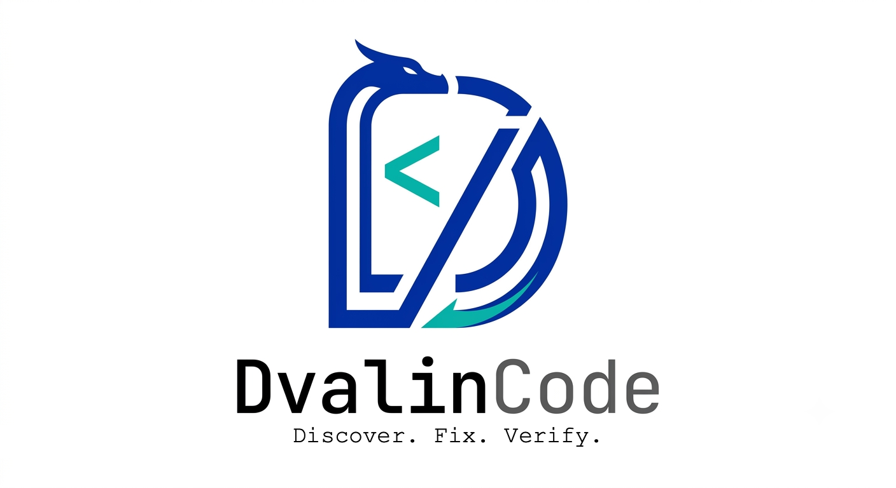
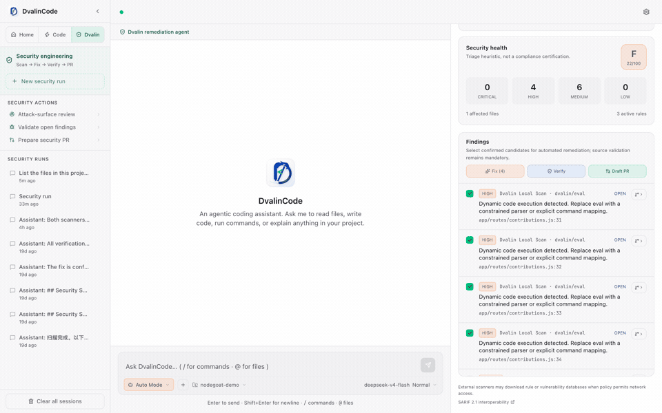

<p align="center">
  
</p>

<p align="center">
  <b>English</b> · <a href="README.zh-CN.md">中文</a> · <a href="https://dvalincode.dev">🌐 dvalincode.dev</a>
</p>

<p align="center">
  <a href="https://github.com/arthurpanhku/dvalincode/releases/latest"></a>
  <a href="https://github.com/arthurpanhku/dvalincode/releases"></a>
  <a href="#-tests"></a>
  <a href="LICENSE"></a>
  <a href="https://scorecard.dev/viewer/?uri=github.com/arthurpanhku/dvalincode"></a>
  <a href="#-two-products-the-cli-and-the-desktop-app"></a>
  <a href="#-providers"></a>
  <a href="README.zh-CN.md"></a>
</p>

<p align="center">
  <b>Open security engineering for code written by humans and AI agents.</b><br>
  <b>Every repair carries its own proof.</b>
</p>

When an agent fixes a security finding, someone has to decide whether the fix
worked. Almost every tool asks the model that wrote it — which is the one
question a model cannot answer against its own interest.

**Dvalin decides instead, and hands you the proof.** It re-scans, runs your
project's own tests itself, and reads the exit codes from processes it started.
Who wrote the repair — our agent, Claude Code, Codex, Copilot, a person — is
recorded and never consulted. The result is a **Verified Fix Record**: a small
JSON file anyone can re-check offline, on a laptop with no network and no
Dvalin state.

```sh
dvalin verify-fix fix-record.json
```
```
Fix record 2c9d71ac03e0 · VERIFIED · scan-and-checks
  executor: claude-code (recorded, not consulted)
  targets: 1 before · 0 remaining
  coverage: complete → complete
  introduced: 0 (gate high/new)
  outcome: verified
  ✓ test: npm run test (exit 0)
  audit: run verify-36509f42 @ 414644c75af0
```

That record says something narrow on purpose: *these findings were gone, and
these checks were observed to pass.* It is not a claim that your code is safe,
and Dvalin will not let it be read as one — every record carries what the scan
actually covered, and a repair no check could confirm does not pass.
[The open profile →](docs/spec/FIX-VERIFICATION.md)

A repair is a change, and a change can add as well as remove. So the record also
carries what the re-scan saw that the first scan did not, and the gate threshold
the verdict was reached under: a fix that removes an `eval` and introduces an SQL
injection is recorded as `regressed` and does not verify. Neither does a record
whose issuer never looked — `introduced: not determined` fails, because a
verifier that skips the question must not score better than one that asks it and
finds something.

Dvalin is the independent security runtime between code generation and merge.
Humans, coding agents, and CI call the same versioned contract for discovery,
remediation, and verification. It runs independently, or interoperates with
specialist systems such as Codex Security through sealed scan artifacts or portable SARIF. Its built-in
coding capability is a remediation executor — not the trust boundary, and not an
attempt to compete with every general-purpose coding agent. See the
[security-agent strategy](docs/SECURITY-AGENT-STRATEGY.md).

---

## 🧭 Two products: the CLI and the desktop app

DvalinCode ships as two products over one engine. Whichever you use, it is the
same policy, the same approvals, the same audit trail and the same
verification; what differs is how you work with it.

| | CLI | Desktop app |
|---|---|---|
| **For** | Terminals and automation: commit and CI gates, pull requests, headless runs, and the coding agents you already use | Working in a window: chat with the agent, read its diffs, approve each change, and run the Dvalin security workspace |
| **Platforms** | macOS · Linux · Windows | macOS · Windows |
| **Released as** | `v*` tags · npm · Homebrew | `gui-v*` tags |
| **Guide** | [CLI guide →](docs/cli.md) | [Desktop app guide →](docs/gui.md) |

Try the scanner in 30 seconds, with no install and no API key:

```sh
npx dvalincode security scan .
```

Install the CLI on macOS or Linux:

```sh
curl -fsSL https://raw.githubusercontent.com/arthurpanhku/dvalincode/main/scripts/install.sh | bash
```

Install the desktop app on macOS (on Windows, run
`dvalincode-gui-v*-windows-x64-setup.exe` from the
[latest desktop release](https://github.com/arthurpanhku/dvalincode/releases?q=gui-v)):

```sh
curl -fsSL https://raw.githubusercontent.com/arthurpanhku/dvalincode/main/scripts/install.sh | bash -s -- --gui
```

Homebrew, Windows and manual downloads are in each guide.
[What's new in each release →](docs/whats-new.md)

---

## 🛡️ What that run actually did

<p align="center">
  
</p>

This animation is made from the real application, not a mock. The input is an
Apache-2.0-licensed example adapted from
[OWASP NodeGoat](https://github.com/OWASP/NodeGoat/tree/c5cb68a7084e4ae7dcc60e6a98768720a81841e8/app/routes),
whose contribution route evaluated user-controlled text.

Dvalin turns open-source scanner evidence into a controlled scan → fix → test →
re-scan → draft-PR workflow. Here is the run in the animation above, measured:

| Real NodeGoat-derived run | Before | After Dvalin remediation |
|---|---:|---:|
| Security health (triage heuristic) | 22 / 100 · F | 100 / 100 · A |
| Findings | 10 (`eval` across 3 rules, 2 engines) | 0 |
| Tests | 2 passing | 3 passing, including an injection regression test |
| Scanner fleet | 4 / 4 completed | 4 / 4 completed |

The scanning and hardening **control plane** uses open-source components:

- [Semgrep CE](https://github.com/semgrep/semgrep) and its community rules for
  semantic SAST.
- [Trivy](https://github.com/aquasecurity/trivy) for filesystem vulnerabilities,
  secrets, and misconfiguration.
- [OSV-Scanner](https://github.com/google/osv-scanner) with the open
  [OSV database](https://osv.dev/) for dependency vulnerabilities.
- DvalinCode's MIT-licensed built-in rules, remediation orchestration, test and
  re-scan gates, plus [SARIF 2.1](https://docs.oasis-open.org/sarif/sarif/v2.1.0/sarif-v2.1.0.html)
  import for other compatible scanners.

The scanners find and rank evidence. The configured model proposes source
changes; DvalinCode constrains that work, records the diff, runs project tests,
re-scans the changed tree, and keeps PR publication explicit. It does not
auto-merge and it does not claim that a clean scan proves the absence of bugs.
Choose an open-weight model through Ollama if the repair-proposal step must also
stay fully local and open; hosted model licensing depends on the provider.

You can still prove what the agent did after the fact:

```sh
dvalincode report verify    # re-derive the hash chain of the last run's audit log
```

---

## 🏛️ And it survives a security review

That last command is the part that matters once more than one person depends on
this. DvalinCode is a full coding agent — terminal, web GUI, and desktop app —
built so that an organization, not the developer, bounds what it may do: a
policy file constrains modes, commands, paths, tools, and models; every run is
hash-chained into a tamper-evident audit log; nothing reaches a provider that
the egress guard did not allow. A repo policy can only ever *narrow* the
machine-level one.

If you are the person who has to approve this class of tool, start at
[APPROVABILITY-PLAN.md](docs/APPROVABILITY-PLAN.md) and the
[Evidence Pack](docs/EVIDENCE-PACK.md) that every release ships of itself.

---

<table>
<tr><td><b>🏠 Home</b></td><td>One place for read-only <b>Ask</b> and approval-gated <b>Collaborate</b> workflows. Switch intent without leaving the project or conversation.</td></tr>
<tr><td><b>⚡ Code</b></td><td>Focused autonomous coding with full tool access and Ask / Plan / Auto / Bypass permission levels. Security and browser routines no longer compete with the core coding workflow.</td></tr>
<tr><td><b>🛡️ Dvalin</b></td><td>Dedicated white-box security engineering: orchestrate the built-in scanner plus installed Semgrep CE, Trivy, and OSV-Scanner; triage findings; create isolated fixes; run tests and re-scan; then explicitly publish a reviewable draft PR. <a href="docs/DVALIN.md">Dvalin guide →</a></td></tr>
<tr><td><b>🏦 Regulated teams</b></td><td>Designed for finance, healthcare, security-sensitive SaaS, and internal platform teams that need AI coding under policy, audit, data minimization, and supply-chain review — not just developer convenience.</td></tr>
<tr><td><b>🛡️ Secure remediation</b></td><td>Run a multi-engine scan or import SARIF from CodeQL, GitHub Code Scanning, Semgrep, or compatible scanners, then create an isolated remediation worktree and turn findings into focused repair tasks with source context, verification evidence, and PR-ready reporting. <a href="docs/SECURE-REMEDIATION.md">Workflow →</a></td></tr>
<tr><td><b>📚 Skills</b></td><td>Upload, download, and inspect local skill bundles. DvalinCode ships built-in secure-code-scan and secure-code-remediation skills, plus agent tools for listing skills, reading skill instructions, scanning, listing cases, and preparing remediation worktrees. <a href="docs/SKILLS.md">Format →</a></td></tr>
<tr><td><b>🛡️ Audit trail</b></td><td>Every run emits a tamper-evident, hash-chained JSONL log — every file read/written, every command, every approval. A Run Report renders it as Markdown; <code>dvalincode report verify</code> proves the chain is intact. <a href="docs/AUDIT-TRAIL.md">Threat model →</a></td></tr>
<tr><td><b>🔒 Org policy &amp; <code>trust</code></b></td><td>A company — not the developer — bounds the agent. A <code>dvalin.policy.json</code> constrains modes, shell commands, file paths, tools, and models; a repo policy can only ever <i>narrow</i> the machine-level one, never widen it. Each run records the governing policy's hash. <code>dvalincode trust</code> prints the install's live security posture — active policy + hashes, audit status, runtime — so a reviewer can verify it directly. <a href="docs/POLICY-REFERENCE.md">Policy reference →</a> · <a href="docs/APPROVABILITY-PLAN.md">Approvability plan →</a></td></tr>
<tr><td><b>🏛️ Governance evidence</b></td><td>OpenSSF Scorecard, CodeQL, Dependabot, pinned GitHub Actions, CODEOWNERS, and ISO/IEC 42001 AIMS alignment docs are maintained as reviewable project evidence, and every release ships an Evidence Pack the binary produced of itself. <a href="docs/security/OPENSSF-SCORECARD.md">Scorecard map →</a> · <a href="docs/governance/ISO-42001-AIMS.md">ISO 42001 alignment →</a> · <a href="docs/RELEASE-EVIDENCE.md">Release evidence →</a></td></tr>
<tr><td><b>📐 Open specs</b></td><td><b>PCP-1</b> — the provider-boundary contract (egress containment, credential containment, audit, policy binding) written as a vendor-neutral profile with test procedures, so any agent runtime can run it against its own adapters and publish the result. Not a DvalinCode test file; a checklist anyone can hold us to as well. <a href="docs/spec/PROVIDER-CONFORMANCE.md">Provider Conformance Profile →</a></td></tr>
<tr><td><b>🖥️ First-class GUI</b></td><td>Modern web UI with code highlighting, file <code>@</code>-references, <code>/</code> slash commands, Git branch indicator, live token + cost counter, multi-profile LLM config, and a dark / light / system theme switcher.</td></tr>
<tr><td><b>🖥️ Terminal or web — one binary</b></td><td>Run it bare for an interactive <b>terminal agent</b> with streaming output, inline approvals, and red/green diffs, or <code>dvalincode serve</code> to host the <b>web GUI</b> for browser/remote use. Both frontends drive the same agent core.</td></tr>
<tr><td><b>🖥️ Native desktop app</b></td><td><code>DvalinCode.app</code> — a real dock application (OS-native webview, no Electron) over the same engine. On macOS the one-line installer with <code>--gui</code> puts it in <code>/Applications</code>; launch it straight from Launchpad. On Windows a per-user setup executable installs it with a Start menu entry and an uninstall entry — no administrator, no UAC prompt, and no browser tab.</td></tr>
<tr><td><b>🪶 Zero-dependency binary</b></td><td>Single ~25MB executable per platform. No Node, no Python, no Docker.</td></tr>
<tr><td><b>🔐 Local-first</b></td><td>Sessions, config, profiles, and audit logs live in <code>~/.dvalincode/</code>. <code>.dvalincodeignore</code> blocks the agent from reading sensitive files. <code>AGENTS.md</code> in your repo becomes persistent project instructions.</td></tr>
<tr><td><b>💾 Portable & exportable</b></td><td>Export <b>all</b> local data (memory, sessions, config, audit) to one file and import it on another machine — your setup moves with you. Any conversation downloads as a clean <b>Markdown</b> transcript.</td></tr>
</table>

---

## 🎯 Core Goal

> **Make every code-producing human or agent pass the same independent security gate.**

DvalinCode is built as an **agent-compatible security runtime**, not another
general coding-agent benchmark entry. The core product is scan evidence,
policy, baseline, deterministic verification, and portable interfaces that a
human developer, an external agent, or CI can all call. The bundled coding agent
stays capable enough to implement and test focused remediations reliably; its
model prose never decides whether the security gate passed.

- **Any model** — every OpenAI-compatible endpoint is a first-class citizen, local models included. Your workflow should never be hostage to one vendor's pricing, rate limits, or quality swings.
- **Safe by default** — three-tier approvals with diff preview, an undo stack, and sandboxed shell execution. An agent you can trust on full-auto.
- **Small enough to audit** — one ~25MB binary, a handful of runtime dependencies, a codebase you can read in a weekend. Trust through inspection, not promises. As of v0.5, **every agent run is auditable too**: a tamper-evident, hash-chained log of every action, verifiable after the fact.
- **Open enough to embed** — the agent core speaks a clean REST + WebSocket API, ready to be wired into your own product, CI, or internal tools.
- **Approvable by any company** — governance is built in, not bolted on. An org policy bounds the blast radius (**controllable**), `dvalincode trust` makes the posture self-verifiable (**transparent**), and the hash-chained log proves what every run did (**auditable**). Those three together are exactly what a security review needs to say yes — and what cloud, closed, mutable-log agents structurally struggle to provide. [Approvability plan →](docs/APPROVABILITY-PLAN.md)

The bundled **web GUI is the runtime's reference implementation and showcase** — the first consumer of that public API, demonstrating everything the runtime can do.

---

## ✅ Why Teams Pick DvalinCode

DvalinCode is differentiated by **approvability**. It is built for teams that
need AI coding to pass security, compliance, and data-governance review before
it can touch production repositories.

- **Closed-loop secure remediation** — scan locally or import SARIF from
  CodeQL, GitHub Code Scanning, Semgrep, or compatible scanners; persist
  findings as local remediation cases; create an isolated
  `dvalin/remediate/...` worktree; then send a focused repair prompt with
  source context and verification instructions.
- **Skills as governed operating procedures** — upload, download, and inspect
  local skill bundles. Built-in secure scanning and remediation skills tell
  agents which tools to use and keep workflows portable across machines.
- **Model freedom without policy drift** — use DeepSeek, OpenAI, Claude via
  OpenRouter, Groq, Ollama, or any OpenAI-compatible endpoint while keeping
  tool permissions, audit, and workspace policy consistent.
- **Security evidence, not just security claims** — OpenSSF Scorecard support,
  CodeQL, Dependabot, pinned Actions, CODEOWNERS, ISO/IEC 42001 alignment docs,
  AI change-impact records, and hash-chained run logs are part of the project.
- **Local-first by default** — sessions, config, profiles, memory, and audit
  logs stay under `~/.dvalincode/`; `.dvalincodeignore` and policy controls
  bound what the agent can read, write, or execute.

---

## 🛡️ Security & Governance

<p align="center">
  <a href="docs/governance/ISO-42001-AIMS.md"></a>
  <a href="docs/EVIDENCE-PACK.md"></a>
  <a href="docs/security/OPENSSF-SCORECARD.md"></a>
</p>

DvalinCode maintains project-level governance evidence for open-source and
enterprise review. This is the differentiator for teams where AI coding must
pass security approval before it can reach production repositories:

- **Threat model** — the full attack surface of an agentic coding runtime
  (malicious `AGENTS.md`, poisoned MCP servers, prompt-injection escalation,
  egress, audit tampering, supply chain, sandbox escape), each mapped to the
  control that defends it and the honest residual gap. [Threat model →](docs/THREAT-MODEL.md)
- **OpenSSF Scorecard support** — scheduled Scorecard workflow, SARIF upload,
  CodeQL, Dependabot, CODEOWNERS, least-privilege workflow permissions, and
  SHA-pinned GitHub Actions. [Control map →](docs/security/OPENSSF-SCORECARD.md)
- **ISO/IEC 42001 alignment** — an AI management system scope, AI policy, role
  map, risk register, AI change classification, required records, and review
  cadence. [AIMS alignment →](docs/governance/ISO-42001-AIMS.md)
- **AI change impact assessment** — a reusable template for changes that affect
  model/provider behavior, prompts, permissions, tools, audit logs, or release
  security. [Template →](docs/governance/AI-CHANGE-IMPACT-ASSESSMENT.md)
- **Regulated-use posture** — local-first data handling, policy-controlled
  autonomy, minimized audit records, and release supply-chain evidence for
  finance, healthcare, security-sensitive SaaS, and internal enterprise use.
- **Dvalin security engineering** — the dedicated Dvalin workspace combines the
  built-in scanner with installed Semgrep CE, Trivy, and OSV-Scanner, normalizes
  SARIF findings, drives isolated test-backed fixes, and explicitly prepares a
  reviewable draft PR without auto-merging it.
  [Workflow →](docs/SECURE-REMEDIATION.md)

These documents are implementation evidence and operating procedures; they do
not claim third-party ISO certification.

---

## 🆚 When to choose DvalinCode

| If you need… | DvalinCode's answer |
|---|---|
| **An agent your security team can approve** | Policy-bound tools, explicit approval modes, `dvalincode trust`, audit logs, OpenSSF evidence, and ISO/IEC 42001 alignment docs. |
| **AI coding for regulated repositories** — finance, healthcare, enterprise data, customer-confidential code | Local-first runtime, bring-your-own-model, `.dvalincodeignore`, governed egress, and minimized audit records. |
| **A safer alternative to generic autonomous coding agents** | The product thesis is controllable / transparent / auditable, not only "the model can edit files". |
| **IDE-centric AI workflows** | Zero-dep binary (~25 MB). Runs anywhere, no IDE required. macOS shell is sandboxed by default — network denied, writes capped to `cwd`. |
| **Terminal-first AI workflows** | CLI start → auto-opens a modern Web UI with code highlighting and red/green diff approval. One install command, nothing else needed. |
| **Cloud-only AI workflows** | Every OpenAI-compatible endpoint is a first-class citizen. Run Ollama with Qwen2.5-Coder: no key, no internet, no per-token cost. |
| **Single-machine AI setup** | `AGENTS.md` committed to the repo ships AI context to every clone. `dvalin.json` ships the team's automation commands the same way — export from the sidebar, commit, done. |

---

## ✨ Features

| Category | Feature | Notes |
|---|---|---|
| **Modes** | Home / Code / Dvalin | Home contains read-only Ask and approval-gated Collaborate; Code is focused autonomous development; Dvalin is the scan-to-fix security workspace |
| **Code permissions** | Ask Permissions / Plan Mode / Auto Mode / Bypass permissions | Verified behavior: Ask requests approval before writes/commands, Plan is read-only and does not write files, Auto runs operations automatically, Bypass runs without confirmation prompts |
| **Workspaces** | Open folder / Import Git / Add worktree | Cowork and Code can switch to a local folder, clone a Git project, or create a Git worktree from the UI |
| **Governance** | OpenSSF Scorecard / ISO 42001 AIMS alignment | Scorecard, CodeQL, Dependabot, pinned Actions, AI impact assessment, risk register, and review cadence are documented under `docs/security/` and `docs/governance/` |
| **Secure remediation** | Built-in + Semgrep CE + Trivy + OSV-Scanner / SARIF / cases / worktrees / tests / draft PR | Dvalin detects installed engines, normalizes SARIF, scores risk, persists cases, drives evidence-backed fixes, verifies changes, and publishes only after an explicit user action |
| **Agent integrations** | `dvalin agents` / MCP server | Finds Claude Code, Codex, Cursor, VS Code, Gemini CLI and OpenCode on this machine and wires Dvalin's MCP server into each, writing only with `--yes`; or hands it to CC Switch. [Editors and MCP →](integrations/mcp/) |
| **Skills** | Upload / download / built-in security skills | Skills live under `~/.dvalincode/skills`; built-ins guide security scanning and remediation with dedicated agent tools. [Format →](docs/SKILLS.md) |
| **Composer** | `@` file references | Type `@` for a fuzzy file search; selected files get inlined into the prompt |
| | `/` slash commands | `/clear` `/compact` `/git` `/plan` `/undo` `/help` |
| | Multiline + interrupt | <kbd>Shift</kbd>+<kbd>Enter</kbd> for newline, stop button to abort mid-stream |
| **Tool UI** | Inline diffs | `edit_file` and `write_file` results render as red/green unified diff, default folded |
| | Approval dialog with diff | Cowork mode shows the diff *before* the change is applied |
| | Live tool counter + token + cost | Topbar shows session totals in real time |
| **Agent** | LLM-based context compaction | `/compact` summarises into Goal / Completed / Decisions / Pending |
| | Persistent undo stack | `/undo [N]` reverses the last N tool calls |
| | Run Report | Markdown summary per run (files, commands, decisions, test result) — GUI card + `dvalincode report` |
| | Git awareness | Branch name in topbar; git context auto-injected into prompt; read-only `git_status`, `git_diff`, `git_log`, `git_show` and `git_blame` tools, also in Ask and Plan |
| | Code search and edits | `search_text` takes regular expressions, shows context lines, and skips `.gitignore`d paths; `edit_file` makes several edits or a replace-all in one call; `read_file` reads line ranges of files over 256 KB |
| | Task checklist | `update_plan` keeps a step checklist that the desktop app shows as a card; in Code mode the agent is sent back if it stops with steps still open |
| | `AGENTS.md` project memory | Per-repo persistent instructions, auto-loaded each turn |
| | Web search + fetch | `web_search` is free by default: it asks Exa's free tier, which needs no key, and your queries go to Exa. If that search fails, for example at Exa's free rate limit, it falls back automatically to a Tavily, Brave Search or Exa API key: the one saved in Settings → LLM Providers → Web search, then `TAVILY_API_KEY`, `BRAVE_API_KEY`, `EXA_API_KEY`. Your own SearXNG endpoint (`DVALINCODE_SEARXNG_URL`) takes Exa's place. Turn the free step off in Settings, or with `"freeWebSearch": false` in `~/.dvalincode/config.json`, which the CLI reads too. `web_fetch` needs no key and reads public pages as text, asking once per site per turn. Both obey the policy `network` level and are audited by origin only |
| **Security** | Tamper-evident audit trail | Hash-chained JSONL per run in `~/.dvalincode/audit/`; `dvalincode report verify` detects edits |
| | macOS shell sandbox | `sandbox-exec` denies network; allows writes only inside cwd + `/tmp` |
| | `.dvalincodeignore` | gitignore-style exclusion; blocks `read_file` / `list_files` / `search_text` |
| | Per-action approval | Approve/deny each write / delete / shell call in Cowork mode |
| **Appearance** | Theme switcher | Dark / light / system, persisted; `system` follows the OS live |
| **Providers** | OpenAI-compatible endpoints | DeepSeek · OpenAI · Groq · OpenRouter · Ollama · custom |
| | Multi-profile config | Save and switch between named (provider, model, API key) sets |
| **Sessions** | Auto-save + restore | All sessions persisted to `~/.dvalincode/sessions/` as JSON |
| | LLM summary memory | Cross-session summary keeps the agent oriented after restart |
| **Memory** | Local user/project memory | Searchable facts, preferences, and decisions in `~/.dvalincode/memory/`; import from Claude/Hermes/Markdown |
| **Data portability** | Export / import all data | One bundle of memory + sessions + config + audit — `dvalincode export` / `import`, or GUI Settings → Export / Import |
| | Markdown transcript | Download any conversation as Markdown — sidebar download icon, `dvalincode session md <id>`, or `/api/sessions/:id/markdown` |

---

## ⌨️ Slash Commands

| Command | Description |
|---|---|
| `/clear` | Clear the current conversation (client-side, starts a fresh session) |
| `/compact` | LLM-based context compaction — replaces history with a structured summary |
| `/undo [N]` | Reverse the last N tool calls (default 1) |
| `/git` | Run `git_status` and show branch, recent commits, changed files |
| `/plan <task>` | Ask the agent to plan the task step-by-step *without* executing |
| `/help` | Show all available slash commands |

---

## 🛠️ Architecture

```
┌───────────────────────────┐   ┌─────────────────────────┐
│  Terminal UI (readline)   │   │  Browser GUI (React/Vite)│
│  streaming · approvals    │   │  ChatThread · DiffViewer │
└─────────────┬─────────────┘   └────────────┬────────────┘
              │ in-process          HTTP / WebSocket
              │                ┌───────────────▼─────────────┐
              │                │  Express + ws server         │
              │                │  /api/* · `dvalincode serve` │
              │                └───────────────┬─────────────┘
              └──────────────┬─────────────────┘
┌────────────────────────────▼────────────────────────────┐
│  runAgentTurn — shared turn-runner (src/agent/session)   │
│  provider · prompt (mode · git · AGENTS.md) · session    │
└────────────────────────────┬────────────────────────────┘
                             │
┌────────────────────────────▼────────────────────────────┐
│                    Agent Engine                          │
│  AgentLoop (8-state machine) → AgentRunner              │
│  Streaming · Interrupt · Undo stack · LLM compaction    │
│  run_start / run_end → AuditSink (hash-chained JSONL)   │
└──────────────────────────┬──────────────────────────────┘
                           │ run()
┌──────────────────────────▼──────────────────────────────┐
│  ToolRegistry — Zod schemas + permission gating         │
│  + audit taps: tool_call · file_* · shell_exec          │
│  read_file · list_files · search_text · git_status ·    │
│  write_file · edit_file · delete_file · shell           │
│  web_search · web_fetch                                 │
│  git_log · git_show · git_blame · update_plan           │
└─────────────────────────────────────────────────────────┘
```

### Agent Loop — 8 States

```
RESTORE → COMPACT → COMMAND → BUILD → RUN → SAVE → RESPOND → DONE
```

1. **RESTORE** — Load session from `~/.dvalincode/sessions/`
2. **COMPACT** — If context near the limit, compress history (LLM summary)
3. **COMMAND** — Handle built-in slash commands
4. **BUILD** — Assemble system prompt (mode prompt + project + git + AGENTS.md)
5. **RUN** — Delegate to `AgentRunner` for the LLM tool-calling loop
6. **SAVE** — Persist session
7. **RESPOND** — Generate cross-session summary memory
8. **DONE**

---

## 🧪 Tests

```sh
npm test
```

**819 core tests · 95 files · all green.** The VS Code extension has a separate
37-test suite plus one opt-in published-package integration test.

---

## 🏗️ Build from source

Requires [Bun](https://bun.sh) (`curl -fsSL https://bun.sh/install | bash`).

```sh
git clone https://github.com/arthurpanhku/dvalincode
cd dvalincode
npm install
npm run dev:all                 # start backend (3001) + Vite (5173)
```

Build release binaries for every platform:

```sh
bash scripts/build-release.sh   # → release/ with tar.gz / zip + SHA256SUMS.txt
bash scripts/build-release.sh darwin    # macOS only
bash scripts/build-release.sh windows   # Windows only
```

Before publishing a release:

```sh
(cd release && shasum -a 256 -c SHA256SUMS.txt)
unzip -l release/dvalincode-v*-windows-x64.zip | grep 'web/dist/index.html'
tar tzf release/dvalincode-v*-macos-arm64.tar.gz | grep 'DvalinCode.app/Contents/Resources/AppIcon.icns'
```

Windows smoke test: unzip `dvalincode-v*-windows-x64.zip` on Windows and run `dvalincode-windows-x64.exe serve` from the extracted folder. The server should open `http://localhost:3000`. If it reports an `ENOENT` path under `B:\~BUN\root\web\dist`, the compiled Bun virtual path detection has regressed; the packaged binary must resolve `web/dist` beside the extracted executable.

Note: Bun only allows Windows `.exe` icon/metadata injection when compiling on Windows. macOS/Linux cross-builds still produce a valid Windows archive, but without an embedded `.exe` icon.

Build the desktop app — and, on a Windows host with [Inno Setup 6](https://jrsoftware.org/isinfo.php), its installer:

```sh
npm run build:gui:darwin    # macOS .app
npm run build:gui:windows   # Windows .exe + dvalincode-gui-v*-windows-x64-setup.exe
npm run icon:windows        # regenerate installer/windows/dvalincode.ico from the app icon SVG
```

The installer is defined by [`installer/windows/dvalincode.iss`](installer/windows/dvalincode.iss) and is compiled only on Windows, because Inno Setup is a Windows program. On any other host the rest of the Windows build still runs and the installer step is skipped with a note.

---

## 🌐 Providers

DvalinCode supports any OpenAI-compatible endpoint. Built-in presets, sorted by cost:

| Provider | Cheapest model | Input / Output | Notes |
|---|---|---|---|
| **Groq** | `llama-3.1-8b-instant` | Free tier | Fastest open models — Llama 3.3 70B, Mixtral |
| **Ollama** | `qwen2.5-coder` | $0 (local) | No API key needed, runs on your machine |
| **DeepSeek** | `deepseek-chat` | $0.14 / $0.28 per 1M | Cheap and strong; v3 nearly matches GPT-4 quality |
| **OpenRouter** | `google/gemini-2.0-flash-001` | $0.10 / $0.40 per 1M | 200+ models including Claude, Gemini, Llama |
| **OpenAI** | `gpt-4o-mini` | $0.15 / $0.60 per 1M | Reliable; `o1` available for deep reasoning |
| **Custom** | — | depends | Any OpenAI-compatible base URL |
| **CC Switch** | — | depends | `provider set cc-switch`: requests go through CC Switch's local routing (`127.0.0.1:15721`) to whichever provider its Codex app uses; CC Switch holds the key |

DvalinCode shows the per-session cost live in the topbar — flip between providers in the **LLM Configuration** modal, save named profiles, and compare on the fly.

---

## ❓ FAQ

<details>
<summary><b>Does it send my code to a third party?</b></summary>
<br>
Only what the agent sends to the LLM you configured. Sessions, configs, and profiles all live on your machine in <code>~/.dvalincode/</code>. To exclude sensitive files from the agent's view, drop a <code>.dvalincodeignore</code> in your repo root (gitignore-style patterns).
</details>

<details>
<summary><b>Can I run this without an API key?</b></summary>
<br>
Yes — use Ollama. Pull a model (<code>ollama pull qwen2.5-coder</code>), then in the LLM Configuration modal pick the <b>Ollama</b> provider. No key, no internet, no per-token cost.
</details>

<details>
<summary><b>Why Home, Code, and Dvalin?</b></summary>
<br>
They represent different outcomes and safety defaults. <b>Home</b> groups read-only Ask and approval-gated Collaborate. <b>Code</b> is the focused software-development agent. <b>Dvalin</b> is a security pipeline with scanner evidence, remediation cases, isolated worktrees, verification, and explicit draft-PR publication. You can switch at any time while keeping project context.
</details>

<details>
<summary><b>Is the shell tool sandboxed?</b></summary>
<br>
On macOS, commands use <code>sandbox-exec</code>; on Linux, restrictive network policies use Bubblewrap when installed. Windows has no supported subprocess network sandbox yet, so restrictive policies fail closed instead of silently running unrestricted. The native command runner itself works on all three platforms.
</details>

<details>
<summary><b>Which operating-system shells are supported?</b></summary>
<br>
Linux and macOS commands run through <code>/bin/sh</code>; Windows commands run through the system <code>ComSpec</code> (<code>cmd.exe</code> by default). Full native command lines support pipes, redirects, and conditional operators. The split <code>command</code> + <code>args</code> form quotes executable paths and arguments for the host shell.
</details>

<details>
<summary><b>How do I see what the agent actually did — and is the log trustworthy?</b></summary>
<br>
Every run writes a JSONL audit log to <code>~/.dvalincode/audit/run-&lt;timestamp&gt;-&lt;id&gt;.jsonl</code>. Render it with <code>dvalincode report --last</code> (or see the collapsible Run Report card in the GUI). Each record is chained to the previous one with a SHA-256 hash, so any after-the-fact edit is detectable — <code>dvalincode report verify &lt;run-id&gt;</code> reports <code>✓ chain intact</code> or the exact position of a break. It's tamper-<b>evident</b>, not tamper-<b>proof</b>: a local attacker who can rewrite the whole file could recompute the chain. The value is forensic/accountability. See <a href="docs/AUDIT-TRAIL.md">docs/AUDIT-TRAIL.md</a> for the full threat model.
</details>

<details>
<summary><b>Will it overwrite my files without asking?</b></summary>
<br>
Depends on the mode. <b>Home → Ask</b> never writes. <b>Home → Collaborate</b> requires approval per file (with inline red/green diff before you click Allow). <b>Code</b> and <b>Dvalin</b> honor their selected permission level; use Auto only for trusted workspaces or isolated branches.
</details>

<details>
<summary><b>The macOS binary won't open — "unverified developer"</b></summary>
<br>
The binary is unsigned. Run this once to clear the quarantine flag:
<pre><code>xattr -dr com.apple.quarantine ~/.dvalincode</code></pre>
Or right-click the binary in Finder → Open → confirm once.
</details>

<details>
<summary><b>Does <code>AGENTS.md</code> get sent every turn?</b></summary>
<br>
Yes — DvalinCode reads <code>AGENTS.md</code> from the project root before each turn and injects it under <code>=== PROJECT INSTRUCTIONS ===</code> in the system prompt. Keep it focused — it counts toward your token budget.
</details>

---

## 🤝 Contributing

Contributions welcome. The codebase is intentionally small and surgical — see [CONTRIBUTING.md](CONTRIBUTING.md).

```sh
git clone https://github.com/arthurpanhku/dvalincode
cd dvalincode && npm install
npm test                # 819/819 core tests ✅
npm run typecheck
```

---

## 📄 License

MIT — see [LICENSE](LICENSE).

---

## 🔗 Independence & Attribution

DvalinCode is an independent implementation. It is not affiliated with,
sponsored by, or endorsed by Anthropic, Claude, Claude Code, OpenAI, OpenAI
Codex, GitHub, Cursor, Aider, opencode, Cline, HKUDS/nanobot, or any other
project or vendor named here.

We gratefully acknowledge that DvalinCode's product direction and architecture
were informed by public research, open-source projects, published papers,
standards, release notes, and common workflow patterns across the agentic coding
ecosystem:

- [HKUDS/nanobot](https://github.com/HKUDS/nanobot) (MIT) helped validate the
  explicit turn-state approach used in DvalinCode's `TurnState` flow.
- The [ReAct paper](https://arxiv.org/abs/2210.03629) (Yao et al., 2022)
  provides the widely used "reason, act, observe" loop that informs many modern
  tool-using agents.
- OpenAI's `tool_calls` message format, along with the broader
  OpenAI-compatible provider ecosystem, gives DvalinCode a portable interface
  for model/tool interaction.
- OpenAI Codex / Codex CLI, Claude Code, Aider, opencode, Cursor, Cline, and
  similar coding agents clarified user expectations around terminal agents,
  plan/build modes, permission prompts, project-local context, sandboxing,
  session lifecycle, MCP integration, and diff-first editing workflows.
- [OpenAI Codex Security](https://github.com/openai/codex-security) and its
  public documentation informed Dvalin's specialist security-agent research and
  portable SARIF handoff. Dvalin remains an independent, competing security
  runtime.
- The `AGENTS.md` project-instruction convention, common in coding-agent tools,
  informed DvalinCode's project-local instruction loading behavior.
- CodeQL, GitHub Code Scanning, Semgrep, SARIF, OpenSSF Scorecard, and ISO/IEC
  42001 informed DvalinCode's security-remediation and approvability posture.
- Git worktree, MCP, and local-first developer tooling patterns influenced the
  product direction for isolated remediation, governed tool access, and
  auditable execution.

These references shaped our understanding of what users expect from coding
agents. DvalinCode's source code, prompts, UI text, tool schemas, module layout,
and product implementation remain original unless explicitly noted. No source
code, prompts, or UI text from the projects above was copied.

Full source references: [docs/REFERENCES.md](docs/REFERENCES.md)

---

## 💛 Thanks to Our Contributors

<p align="center">
  Every issue, idea, documentation improvement, test, and code contribution helps make DvalinCode better.
</p>

| Contributor | GitHub profile |
| --- | --- |
| Arthur Pan | [@arthurpanhku](https://github.com/arthurpanhku) |
| Shivas | [@shivasb42](https://github.com/shivasb42) |
| Aditya | [@adity982](https://github.com/adity982) |
| badhope | [@weed33834](https://github.com/weed33834) |
| Samran Asif | [@webdevsamran](https://github.com/webdevsamran) |
| dchaudhari7177 | [@dchaudhari7177](https://github.com/dchaudhari7177) |
| TayfurYldz | [@TayfurYldz](https://github.com/TayfurYldz) |

See the [complete contribution history](https://github.com/arthurpanhku/dvalincode/graphs/contributors), including automated dependency and maintenance updates.

<p align="center">
  <sub>Want to join them? Read the <a href="CONTRIBUTING.md">contribution guide</a> and send your first pull request.</sub>
</p>
