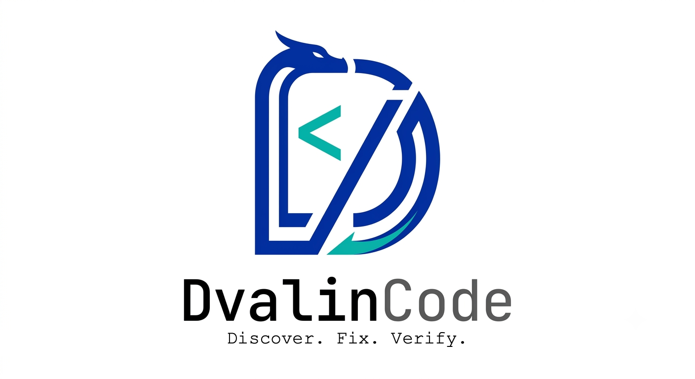
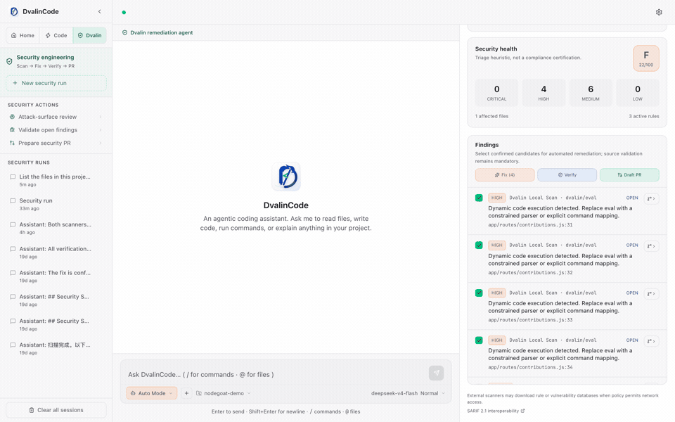

<p align="center">
  
</p>

<p align="center">
  <a href="README.md">English</a> · <b>中文</b> · <a href="https://dvalincode.dev/zh/">dvalincode.dev</a>
</p>

<p align="center">
  <a href="https://github.com/arthurpanhku/dvalincode/releases/latest"></a>
  <a href="LICENSE"></a>
  <a href="https://scorecard.dev/viewer/?uri=github.com/arthurpanhku/dvalincode"></a>
</p>

<h3 align="center">扫描器找问题，Agent 写修复，Dvalin 判定修复是不是真的。</h3>

<p align="center">开源、供应商中立的安全修复裁判。<br>每一次判定都在你的机器上完成，也留存在你的机器上。</p>

你的编码 Agent 说它修好了漏洞，Dvalin 来核实：用你 CI 门禁本来就在跑的扫描器重新扫描，
亲自运行你项目自己的测试，看退出码。判定里没有任何模型的意见，写修复的那个模型更没有。
你拿到的是一份 **Verified Fix Record**：一个很小的 JSON 文件，任何人都能离线复验。

```sh
npx dvalincode security scan .    # 30 秒：不用安装，不用账号，不用 API Key
```

## 它要终结的循环

扫描器拦下了你的 PR。你把 finding 交给编码 Agent，它的补丁回到 CI，又被扫描器拦下：
问题还在，补丁引入了新问题，或者 Agent 让扫描器闭了嘴，代码却没修好。于是有人一轮又
一轮地手动转述扫描结果、手动 rebase。

Dvalin 在这个循环里坐裁判席。它把还没解决的问题准确告诉修复方，每一轮都用 CI 的同一把
尺子来判，修复站得住才停。

## Dvalin 的位置

| | 找问题 | 写修复 | 判定修复是否成立 |
|---|:---:|:---:|:---:|
| **扫描器**：Semgrep、Snyk、CodeQL、Trivy、OSV-Scanner | ✓ | | |
| **编码 Agent**：Claude Code、Codex、Cursor、Copilot，或者人 | | ✓ | |
| **模型厂商的安全 Agent**：Codex Security、Claude Security | ✓ | ✓ | 在它们自己的产品里 |
| **Dvalin** | 调用你的扫描器 | 把活交给你的 Agent | ✓ 公开透明，在你的机器上 |

Dvalin 不是又一个扫描器，也不是又一个编码 Agent。它是两者之间的裁判，不管哪个 Agent
写的修复，判定标准都一样。内置规则让你什么都不装也能完成第一次扫描，内置 Agent 也可以
充当修复方，两者都是可选的。

模型厂商的安全 Agent 在一个产品里完成发现、修复和验证，依赖的是该厂商自己的模型和 API。
Dvalin 可以导入它们的发现，并像对待其他修复一样判定它们的修复。它自己的判定有三点不同：

- **开源。** 得出判定的代码以 MIT 许可开源，默认使用的扫描器也都是开源的。裁判用的每一条
  规则，你都能读、能自己跑、能 fork。
- **供应商中立。** 任何 Agent、任何扫描器、任何模型 provider 都行，也可以完全不用模型。
  得出判定不需要账号、不需要 API Key，也不需要任何厂商的云。
- **留存在本地。** 扫描结果、Dvalin 跑过的检查、fix record，以及记录判定过程的哈希链日志，
  都留在你的仓库和 `~/.dvalincode/` 里。默认情况下，判定不会把任何代码发出去；会上传源码
  的引擎（比如 Snyk Code）只有在你点名时才会运行。

## 判定为什么站得住

- **判定里没有模型。** 依据是 Dvalin 自己启动的进程返回的退出码，以及与你 CI 门禁相同
  的引擎复扫的结果。它从不问修复方修得怎么样。
- **修复方没法挪球门。** 改动自己新增的忽略项（`.snyk`、`nosemgrep`、`nosec` 等）在判定
  这次改动时不算数。在 CI 里，检查项、门禁和扫描器都取自基线提交，PR 没法放宽用来判它
  的规则。
- **让扫描器闭嘴不算修复。** 把 sink 换成同类写法（`eval` → `new Function`）、删掉有漏洞
  的文件、删测试或删断言，都判为不通过。
- **先复现，再修复。** 对代码类 finding，测试必须在未修复的代码上失败，在修复后原样通过。
- **证明可以带走。** 记录离线就能复验，不需要工作区，也不需要联网。在 CI 里，runner 可以
  重新执行验证，并对它观察到的结果签名。

```sh
dvalin verify-fix fix-record.json
```
```
Fix record 2c9d71ac03e0 · VERIFIED · scan-and-checks
  executor: claude-code (recorded, not consulted)
  targets: 1 before · 0 remaining
  coverage: complete → complete
  introduced: 0 (gate high/new)
  outcome: verified
  ✓ test: npm run test (exit 0)
  audit: run verify-36509f42 @ 414644c75af0
```

### “verified”是什么意思，不是什么意思

这份记录刻意只说很窄的事：*这些 finding 原本存在；改动之后，复扫不再报告它们；这些命令
运行过，Dvalin 观察到了这些退出码。* 它没有说代码是安全的。每份记录都带着这次扫描的覆盖
范围（`complete`、`partial` 或 `unknown`）。没有任何检查能确认的修复不会通过；消除了一个
finding 却引入另一个的修复会记为 `regressed`。规避检测基于已知模式，局限列在
[诚实的差距](docs/SECURITY-AGENT-STRATEGY.md#honest-gaps-today)里（英文）。
[开放规范 FVP-1 →](docs/spec/FIX-VERIFICATION.md)

## 在你已有的工具里用

**在编码 Agent 里。** Dvalin 是一个 MCP server。把它接进这台机器上的 Agent（Claude Code、
Codex、Cursor、VS Code、Gemini CLI、OpenCode）：

```sh
npx dvalincode agents connect         # 预览每个 Agent 会得到什么
npx dvalincode agents connect --yes   # 执行
```

Agent 写完修复后调用 `dvalin_verify_findings`，就能拿回一份 Verified Fix Record。

**在每个 PR 上。** GitHub Action 不需要 API Key，也不需要模型：

```yaml
- uses: arthurpanhku/dvalincode@v0.24.0
  with:
    fail-on: high
    diff: true    # 只拦这个 PR 新增的问题
```

传入 `fix-record:`，runner 会复验这份记录，再把结果贴在 diff 旁边；加上 `reverify: true`，
runner 会亲自重新执行一遍验证。GitLab CI 和 pre-commit 的用法见 [CLI 指南](docs/zh/cli.md)。

**在终端里。** 让 Dvalin 驱动修复方，直到门禁能够通过：

```sh
dvalincode dvalin . --until-clean --max-rounds 3 --executor codex
```

每一轮，Dvalin 都会重新扫描、运行你的检查，只把还没解决的问题发回给执行方。修复通过验证、
轮数用完或进展停滞时，循环停止；无论哪种结局，都会签发一份 fix record。

## 一次真实运行

<p align="center">
  
</p>

动图录自真实应用，不是设计稿。输入代码改编自 Apache-2.0 许可的
[OWASP NodeGoat](https://github.com/OWASP/NodeGoat/tree/c5cb68a7084e4ae7dcc60e6a98768720a81841e8/app/routes)，
其 contribution route 会执行用户可控的文本。

| | 修复前 | 修复后 |
|---|---:|---:|
| 安全健康分（分诊启发式） | 22 / 100 · F | 100 / 100 · A |
| 发现项 | 10 条（2 个引擎、3 条规则命中 `eval`） | 0 条 |
| 测试 | 2 条通过 | 3 条通过，新增一条注入回归测试 |
| 扫描器 | 4 / 4 完成 | 4 / 4 完成 |

## 安装

Dvalin 随 `dvalincode` 包发布，带两个命令：`dvalin` 负责安全流程，`dvalincode` 包含全部
功能，包括内置 Agent。

**CLI**（macOS · Linux · Windows）：

```sh
curl -fsSL https://raw.githubusercontent.com/arthurpanhku/dvalincode/main/scripts/install.sh | bash
```

Homebrew、Windows 和手动下载见 [CLI 指南](docs/zh/cli.md)。

**桌面应用**（macOS · Windows）：把同一个引擎放进窗口，带 Dvalin 安全工作区和内置 Agent。
见[桌面应用指南](docs/zh/gui.md)。

[Code signing policy（代码签名政策）](docs/CODE-SIGNING.md) · [隐私说明](docs/PRIVACY.md)。
正在准备 SignPath Foundation 免费 Windows 签名申请，尚未确认获批或启用正式签名。

[每个版本的新功能 →](docs/zh/whats-new.md)

## Dvalin 适合你吗？

**适合，如果**

- 编码 Agent 正在修你扫描器报出的问题；
- 你用不止一个 Agent 或扫描器，想要一个统一的判定；
- 你必须向审计方证明某个修复真的有效；
- 判定必须公开透明、不依赖任何一家 AI 厂商，并且留在你自己的机器上。

**大概不适合，如果**

- 你要找的是编码 Agent：用 Claude Code、Codex 或 opencode，再把 Dvalin 接进去；
- 你要的是最广的漏洞发现能力：用专门的扫描器或 AI 安全 Agent；
- 你只用一个扫描器配它自家平台的自动修复，也没人要求你拿出证明。

## 文档

- [CLI 指南](docs/zh/cli.md)：门禁、修复循环、CI、MCP 和无头运行
- [桌面应用指南](docs/zh/gui.md)
- [内置 Agent](docs/zh/agent.md)：模式、工具、Provider、架构和常见问题
- [信任与治理](docs/zh/trust.md)：组织策略、审计日志、威胁模型和证据
- 以下页面目前只有英文：[验证是怎么工作的（FVP-1）](docs/spec/FIX-VERIFICATION.md)、
  [Dvalin 安全工作区](docs/DVALIN.md)（扫描器、SARIF 和 Codex Security 导入）、
  [安全战略](docs/SECURITY-AGENT-STRATEGY.md)（Dvalin 在哪里竞争，在哪里不竞争）

## 贡献

欢迎贡献。环境搭建、治理规则和源码构建见 [CONTRIBUTING.md](CONTRIBUTING.md)。感谢每一位
帮过忙的贡献者：[@arthurpanhku](https://github.com/arthurpanhku)、
[@shivasb42](https://github.com/shivasb42)、[@adity982](https://github.com/adity982)、
[@weed33834](https://github.com/weed33834)、[@webdevsamran](https://github.com/webdevsamran)、
[@dchaudhari7177](https://github.com/dchaudhari7177) 和
[@TayfurYldz](https://github.com/TayfurYldz)
（[完整贡献记录](https://github.com/arthurpanhku/dvalincode/graphs/contributors)）。

## License 与致谢

MIT，详见 [LICENSE](LICENSE)。DvalinCode 是独立项目，与本文提到的任何厂商或项目（包括
Anthropic、OpenAI 和 GitHub）都不存在从属、赞助或背书关系。启发过它的公开研究、开源项目
和标准，完整致谢见 [docs/REFERENCES.md](docs/REFERENCES.md)。
