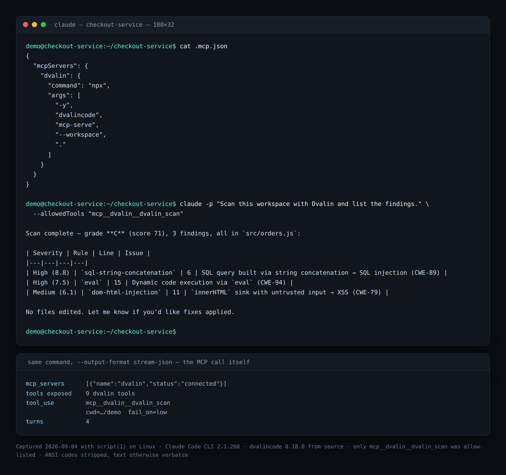
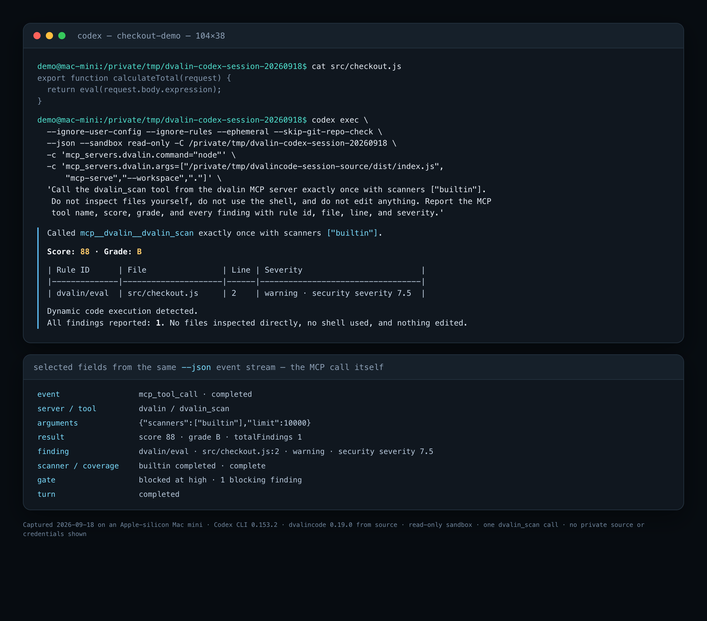
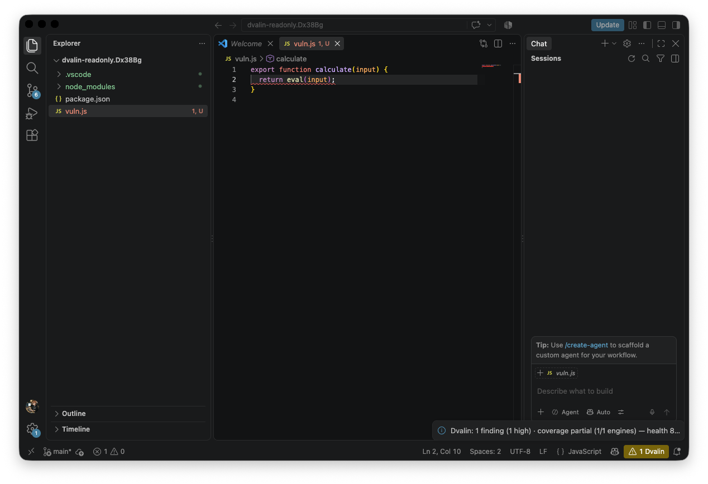

# DvalinCode CLI

**English** · [中文](zh/cli.md)

The CLI is DvalinCode for terminals and automation: an interactive terminal
agent, the Dvalin security scanner, headless runs for CI and schedulers, and an
MCP server for the coding agents you already use. It runs on macOS, Linux and
Windows. The [desktop app](gui.md) is the other product: the same engine, in a
window. What both share — providers, the security model, the architecture, the
FAQ — is in the [README](../README.md).

## 🚀 Install

### Homebrew (macOS / Linux)

```sh
brew tap arthurpanhku/dvalincode https://github.com/arthurpanhku/dvalincode
brew install arthurpanhku/dvalincode/dvalincode
```

Installs the same signed-by-checksum release archive the one-liner does, and
`brew upgrade` keeps it current. Homebrew never applies the macOS quarantine
attribute, so this path is not subject to Gatekeeper.

### One-line installer (macOS / Linux)

```sh
curl -fsSL https://raw.githubusercontent.com/arthurpanhku/dvalincode/main/scripts/install.sh | bash
```

Detects your OS + arch, downloads the right binary, installs to `~/.dvalincode/`,
and adds it to your `PATH`. It installs the CLI only; the desktop app
[installs separately](gui.md).

After installing the CLI, reload your shell:

```sh
source ~/.zshrc    # or ~/.bashrc
dvalincode                       # interactive terminal agent
dvalincode dvalin .              # white-box security scan (GUI-independent)
dvalincode serve                 # start the web GUI, open the browser
dvalincode serve --host 0.0.0.0 --no-open   # host it on a server; open the printed ?token= link
echo "inspect src and summarize" | dvalincode run - --output-format stream-json
dvalincode mcp-serve             # task-level stdio MCP server for external agents
```

### Windows

Download `dvalincode-v*-windows-x64.zip` from
[Releases](https://github.com/arthurpanhku/dvalincode/releases/latest) and
unzip it. In a terminal, `dvalincode-windows-x64.exe` opens the terminal agent
and `dvalincode-windows-x64.exe serve` serves the web GUI; keep `web\dist`
beside the `.exe`.

### Manual download

Grab the archive for your platform from the [Releases page](https://github.com/arthurpanhku/dvalincode/releases/latest):

| Platform | Archive |
|---|---|
| macOS Apple Silicon (M1/M2/M3) | `dvalincode-v*-macos-arm64.tar.gz` |
| macOS Intel | `dvalincode-v*-macos-x64.tar.gz` |
| Windows x64 | `dvalincode-v*-windows-x64.zip` |
| Linux ARM64 | `dvalincode-v*-linux-arm64.tar.gz` |
| Linux x64 | `dvalincode-v*-linux-x64.tar.gz` |

Verify against `SHA256SUMS.txt` (included in each release).

Each release also ships **`dvalincode-v*-evidence.json`** — an Evidence Pack the
shipped binary produced of itself on the build machine: two real governed runs,
one allowed and one blocked by policy, with their hash chains. You can check the
claims on this page before installing anything:

```sh
dvalincode evidence verify dvalincode-v0.14.0-evidence.json   # offline, reads only the file
```

The pack's checksum is inside `SHA256SUMS.txt`, which is the subject of the
release's build-provenance attestation. [How it is produced →](./RELEASE-EVIDENCE.md)

> **macOS Gatekeeper:** binaries are unsigned. On first run, either clear the quarantine flag with `xattr -dr com.apple.quarantine ~/.dvalincode`, or right-click the binary in Finder → Open → confirm.

---

## 🎬 First run

Run `dvalincode`. On first launch it walks you through a one-time provider setup (pick a provider, paste your API key, choose a model) and saves it to `~/.dvalincode/config.json`. Then you're at the prompt — type to chat, `/mode` to switch between Chat / Cowork / Code / Dvalin, `/help` for commands. In the GUI, Chat and Cowork are the **Chat** workspace, as Ask and Collaborate in the composer's mode menu.

Your config and sessions live in `~/.dvalincode/`, shared with `dvalincode serve` and the desktop app.

---

## ⏱️ 30 seconds, no install, no API key

```sh
npx dvalincode security scan .
# After installing the package: dvalin scan .
```

That is the whole thing. It runs the built-in rules for injection, hardcoded
secrets, XSS, `eval`, and unsafe shell use against the current directory and
prints what it found. No account, no model, no config, no code leaves your
machine. The default policy runs only Dvalin Built-in, so the first scan always
works. Add optional engines explicitly, or inspect their fixed install commands:

```sh
dvalin scanners list
dvalin scanners install semgrep       # review the command
dvalin scanners install semgrep --yes # execute it under Dvalin policy
```

### Make it the gate in one step

```sh
dvalin init
```

`init` writes `dvalin.security.json` (fail on *new* findings at high or above),
names the checks your project actually has (`test`, `typecheck`, `build`,
`lint`) as what Dvalin runs before it calls a fix verified, records today's
findings as the accepted backlog in `.dvalin/baseline.json`, and writes a CI
gate for GitHub (`.github/workflows/dvalin.yml`) or GitLab
(`.gitlab/dvalin-security.yml`, with a Code Quality report for the merge
request widget). It never overwrites a file that is already there unless you
pass `--force`. Commit what it wrote, and the backlog stops blocking anyone:
only what a change adds fails.

To gate every commit locally too, add the [pre-commit](https://pre-commit.com) hook:

```yaml
# .pre-commit-config.yaml
repos:
  - repo: https://github.com/arthurpanhku/dvalincode
    rev: v0.24.0          # the hook ships in v0.22.0 and later
    hooks:
      - id: dvalin-scan   # or dvalin-scan-installed, to use the CLI you installed
```

### Measure with the scanner your CI gate uses

If Snyk is what blocks your merges, verify against Snyk. A fix judged "clean"
by a different engine is a fix the gate can still reject, and that mismatch is
what turns one agent repair into several rounds of push, fail, and rebase.

```sh
npm install -g snyk && snyk auth      # or set SNYK_TOKEN
dvalin scan . --scanners builtin,snyk-code,snyk-oss
```

`snyk-code` (SAST) and `snyk-oss` (dependencies) are engines like any other:
their findings carry the same fingerprints, coverage and gate, and a failed
login is reported as an engine error, which makes the scan `partial`, never
clean. They run only when named, because Snyk Code uploads source to Snyk.
Name them in `dvalin.security.json` to make them part of the policy, and
`reverify` will judge every fix with them.

If GitHub code scanning is the gate, use CodeQL the same way:

```sh
dvalin scan . --scanners builtin,codeql
```

`codeql` builds one database per language outside the workspace and runs that
language's default code-scanning queries, so its findings are the ones the gate
reports. JavaScript/TypeScript, Python, Ruby, Java and C# are analysed without a
build; Go uses CodeQL's autobuild. Kotlin, C/C++ and Swift need the project's own
build, so when they are in the tree the run says so and the scan is `partial`,
not clean. It runs only when named — a database takes minutes, not seconds, and
the CodeQL CLI's license covers open-source code and GitHub Advanced Security
customers.

Ignores Snyk itself reports as accepted are honored and listed as coverage
exclusions. Ignores **the change under review adds** are not: when a fix is
judged, `.snyk`, `.semgrepignore`, `.trivyignore` and `.dvalincodeignore` are
restored to the base commit's version and new inline markers (`deepcode
ignore`, `nosemgrep`, `nosec`, `NOSONAR`, …) are blanked, so a finding that was
silenced rather than fixed still fails the fix. A suppression is a risk
decision a person makes in its own change, never a repair.

The same judgement applies wherever Dvalin says "verified": the fix loop,
`dvalin verify`, the MCP `dvalin_verify_findings` tool, single-round
`--fix --verify`, and CI `reverify`. Those records are `dvalin-fix-record/v3`,
which also fails a repair that hid a finding instead of fixing it — a sibling
sink, a deleted vulnerable file, deleted tests or assertions. Outside a git
repository, where the change cannot be determined, records stay v2 and say
that evasion was not evaluated.

### Let it loop until the gate would pass

```sh
dvalincode dvalin . --scanners builtin,snyk-code,snyk-oss --until-clean --max-rounds 3 --executor codex
```

`--until-clean` turns one fix attempt into a bounded loop. The executor edits;
Dvalin re-scans with the same engines and runs the project's checks itself;
the executor is sent **only what is still wrong** — targets still present,
findings its change introduced, failing checks with their last lines of
output, suppressions it added — and fixes again. Dependency findings go first.

The loop stops, and says which, when every target is gone with nothing
blocking introduced and every check passing (`verified`), when the round
budget runs out, when a round leaves the same problems open or the open set
stops shrinking (`stalled`), when the targets need a person — a dependency
with no fixed version (`not-auto-fixable`) — or when the engines or checks
cannot run (`unverifiable`). Suppressions the executor adds are undone before
each scan and stay open problems until removed. Every outcome issues a fix
record, and every round is logged under `~/.dvalincode/security/fix-loops/`;
`dvalin loop-stats` summarizes those logs — how often loops reach `verified`,
the median and p90 rounds to green, which stop rule fired, and what was still
open when a loop stalled (`--json`, `--since`, `--executor` to slice it).

Rounds are kept short without changing what decides them. The engines run side
by side, so a scan costs the slowest engine rather than the sum. Between rounds,
the engines that analyse one file at a time (Dvalin Built-in, Semgrep) rescan
only the files the change touched and the files the targets are in; the others
always scan the whole tree. That narrowed scan only steers the executor: any
round that would stop the loop is re-judged on a full scan of the same tree, and
only the full scan decides the outcome and goes into the record.
`--full-rescan` scans everything every round, and `loop-stats` reports scan time
per round and how often a full scan changed the decision.

For **code** findings the loop first asks for a reproduction: tests only, which
Dvalin runs on the unfixed code and requires to fail — by a failing assertion,
not a missing runner or a not-yet-written import. The tests are hashed; the
fix must then make them pass **unchanged**, and that run is a check in the
record. A finding no test could demonstrate stops the loop as
`not-reproduced` before anything is fixed: it may be a false positive, and a
person triages it. The runner is inferred (vitest, jest, mocha, `node --test`,
pytest, `go test`) or set with `--repro-command 'npx vitest run {files}'` or
`reproduce` in `dvalin.security.json` — never chosen by the executor.

Each fix round also rejects the evasions an agent reaches for when the goal is
"the scanner went quiet": moving the sink to a sibling (`eval` →
`new Function`, `exec` → `spawn` with `shell: true`), deleting the vulnerable
file, deleting tests, removing assertions. In practice the scanner alone is
fooled by the first one — the rule stops matching — and the reproduction test
and the evasion check are what catch it.

### Keep it on today's main, and close it in CI

```sh
dvalincode dvalin . --scanners builtin,snyk-code,snyk-oss --until-clean \
  --rebase-onto origin/main --executor codex --draft-pr --sign-key ci.key
```

With `--rebase-onto` the loop fetches and rebases the fix onto upstream before
it starts and after every round, then judges it there. Conflicts go to the
executor — the conflicted files only, with "do not run git" — and Dvalin
continues the rebase itself; markers left in a file are a conflict not
resolved. If they cannot be resolved the rebase is aborted, the tree is left as
it was, and the loop stops as `rebase-conflict`. After each rebase the baseline
is re-scanned on the new base, so a finding a teammate landed on main is not
blamed on the fix.

`--draft-pr` commits the record at `.dvalin/fix-record.json`, and
[`docs/examples/dvalin-fix-loop.yml`](./examples/dvalin-fix-loop.yml)
re-executes it on the pull request with `reverify: true`: base and head
re-scanned, checks re-run, and the reproduction re-run with the fix reverted in
place (it must fail) and restored (it must pass) — then signed with the CI key.

For an incremental “no new high-risk findings” gate, commit the policy and
baseline with the repository:

```sh
dvalin init
dvalin baseline
dvalin scan
```

This creates `dvalin.security.json` and `.dvalin/baseline.json`. Suppressions
require a reason and may have an owner and expiry date. Scan output is a
versioned envelope with a deterministic gate result and a resumable workflow ID.

### Or put it on every pull request — nothing to install at all

```yaml
# .github/workflows/security.yml
permissions:
  contents: read
  security-events: write
steps:
  - uses: actions/checkout@v5
    with:
      fetch-depth: 0        # so the scan can reach the base commit
  - uses: arthurpanhku/dvalincode@v0.24.0
    with:
      fail-on: high
      diff: true            # only report on what this PR changed
```

Findings land inline on the pull request diff and in your Security tab.
No API key, no secrets, no model — the scan is deterministic and local to the
runner. [Full example →](./examples/dvalin-scan.yml)

`diff: true` reports only on lines the pull request changed, so the gate blocks
what this change *adds* instead of everything the repository already carried.
That is what makes the check adoptable on a codebase that was not clean to
begin with. Drop it to scan the whole repository.

Every comment states what the scan **covered** — `complete`, `partial`, or
`unknown` — beside the result, because "no findings" from a run where half the
engines were missing is not the same answer as "no findings" from a complete one.

### And publish the proof next to the diff

If your pipeline produced a fix record, hand it to the same action:

```yaml
  - uses: arthurpanhku/dvalincode@v0.24.0
    with:
      fix-record: fix-record.json
```

The runner re-derives the record from the file alone — recomputing its hash and
re-deriving its verdict from its own evidence — and posts the result on the pull
request. A record that was edited after it was issued fails here, and fails the
job.

Re-derivation proves the record is *self-consistent*. It cannot prove the record
was issued by anyone who actually ran anything: every field in it, the exit
codes included, is something a forger could write, and a self-consistent
forgery re-derives. Two things close that gap — re-execute the claim on the
runner, and sign what the runner observed.

```
🔏 Verified Fix Record
✅ ce504a995395 · VERIFIED · scan-and-checks
- repaired by claude-code — recorded, and not consulted for this verdict
- targets: 1 before → 0 remaining
- coverage: complete → complete
- introduced: none (gate high/new)
- outcome: verified
- ✓ test: `npm run test` (exit 0)
- audit chain: verify-eeb1bae7 @ 80881867270d
```

A repair that regressed says so in the same place, and fails the job with it:

```
❌ 916e2eeaf065 · NOT VERIFIED · scan-and-checks
- introduced: 1 finding(s) the first scan did not report (gate high/new)
  - critical dvalin/sql-injection — src/db.ts:31
- outcome: regressed
```

### Re-execute it on the runner, and sign what you saw

```yaml
  - uses: actions/checkout@v5
    with:
      fetch-depth: 0              # the base commit has to be reachable
  - run: npm ci                   # the project's checks run on the runner
  - uses: arthurpanhku/dvalincode@v0.24.0   # reverify needs v0.22.0 or later
    with:
      fix-record: fix-record.json
      reverify: true
      signing-key: ${{ secrets.DVALIN_SIGNING_KEY }}   # optional
```

With `reverify: true` the claimed record contributes only *which targets* it
says it fixed and *who* the executor was. Everything else is observed again:

- the **base** commit is checked out and scanned, so each claimed target must
  actually have existed there — a record cannot take credit for removing a
  finding nobody had;
- the **head** is scanned, so "gone" is observed on the runner;
- the project's checks are run on the runner, with the checks, gate and
  scanners read from the **base** commit's `dvalin.security.json` — a pull
  request that relaxes its own gate or deletes its own checks is judged under
  the rules it is trying to change;
- a fresh record is issued from those observations, and the job fails unless it
  verifies.

With `signing-key` the fresh record is signed (Ed25519, over its hash). The key
is taken into memory and removed from the environment before the project's
checks run, so the code under review cannot read it. Downstream — a release
job, another repository, an auditor — can then require that signature:

```sh
dvalin keygen --out ci                          # once; store ci.key as a secret, publish ci.pub
dvalin verify-fix record.json --trusted-key ci.pub
```

A record that is unsigned, or signed only by a key you did not name, fails
under `--trusted-key`. A valid signature says *which key vouched for this
record*; whether that key deserves trust is your decision, and the reason to
trust a CI key is that the CI job re-executed the verification rather than
copying it. Locally, `dvalin reverify <record> --base origin/main` runs the same
re-execution, and `dvalin sign-fix` signs a record that re-derives.
[FVP-1 §4a, §5a →](./spec/FIX-VERIFICATION.md)

### Or let your agent call it

If an agent is writing the code, something other than that agent has to check
it. DvalinCode is an MCP server, so any agent that speaks MCP can:

```sh
claude mcp add dvalin -- npx -y dvalincode mcp-serve --workspace .
```

One command configures the editor you actually use:

```sh
npx dvalincode mcp-install codex         # ~/.codex/config.toml, via `codex mcp add`
npx dvalincode mcp-install cursor        # .cursor/mcp.json
npx dvalincode mcp-install vscode        # .vscode/mcp.json
npx dvalincode mcp-install claude-code   # .mcp.json
npx dvalincode mcp-install gemini        # .gemini/settings.json
npx dvalincode mcp-install opencode      # opencode.json
```

For Codex, Dvalin delegates to the official `codex mcp add` command, so it safely
updates TOML without hand-editing user configuration. The other formats differ
in a way that fails silently — VS Code keys its servers under
`servers`, Cursor under `mcpServers` — so the command writes the right one and
merges into whatever is already there. [Editors and MCP →](../integrations/mcp/)

Or let Dvalin find them. `agents` lists the coding agents on this machine and
where Dvalin is already connected; `agents connect` plans the rest, and writes
nothing until you add `--yes`:

```sh
npx dvalincode agents                 # which agents are here, and which have Dvalin
npx dvalincode agents connect         # the plan: what each agent gets
npx dvalincode agents connect --yes   # apply it
```

If you manage MCP servers with [CC Switch](https://github.com/farion1231/cc-switch),
`agents connect cc-switch --yes` hands Dvalin to it instead. CC Switch shows the
import, asks first, then syncs Dvalin into Claude Code, Codex, Gemini CLI and
OpenCode.

`dvalin_scan` accepts `diff: "uncommitted"`, which reports only on what the
agent just wrote rather than everything the repository already carried — the
difference between a usable answer and a wall of pre-existing findings. It never
runs a model, edits the target workspace, or persists Dvalin state, so clients
can allow the preview by default. When a finding will be repaired, the agent
explicitly calls `dvalin_begin_verification` to record a small local workflow;
it can then retrieve the finding by fingerprint and request an independent
re-scan through `dvalin_get_finding` and `dvalin_verify_findings`.

That last one is the point: an agent that has just written a repair can ask for
an independent verdict on it. Dvalin re-scans, runs the project's own checks
itself, and returns a **Verified Fix Record** — what was targeted, what remains,
what the repair introduced that was not there before, the gate the verdict was
reached under, which commands ran and the exit codes Dvalin observed, and how
much of the codebase was actually covered. Whoever wrote the repair is recorded
and never consulted. `dvalin_verify_fix` re-derives such a record offline, so the reviewer
receiving it does not have to trust the tool that issued it.
[FVP-1 →](./spec/FIX-VERIFICATION.md) Responses include MCP `structuredContent`; scanner
readiness is available through `dvalin_list_scanners`. The same server exposes
`dvalin_run_task` as an optional implementation helper, plus session and audit
evidence tools.

Every client below has been driven to a real tool call rather than only a
handshake — which client, which version, and on what date is a table rather
than a sentence, because hand-written version numbers go stale quietly.
[Integration support ↓](#-integration-support) · [Agent integrations →](../integrations/)

The repository also contains one [portable Codex/Claude plugin payload](../integrations/dvalin-security/)
with the current root Agent Plugins manifest, compatibility manifests, the
shared security-gate skill, and a Claude-compatible MCP configuration. A repo-local
marketplace makes it discoverable in Codex desktop; installing it lets task
context trigger the gate instead of requiring every developer to remember a scan prompt.
For Codex, `mcp-install codex` separately binds the server to the active project;
the plugin does not risk scanning its own installed cache directory.
Codex honors the scan's read-only MCP annotation. Claude Code requires one
explicit MCP permission by design; the plugin documents the exact scan-only
allow rule instead of asking users to bypass all permissions.

### Wherever you already work

One server, reached the way each tool expects:

| Harness | How Dvalin reaches it |
|---|---|
| **Claude Code** | [portable plugin](../integrations/dvalin-security/) or `claude mcp add` · [standalone skill](../integrations/claude-code/) |
| **Codex** | `dvalincode mcp-install codex` · [portable plugin](../integrations/dvalin-security/) · [sealed scan + SARIF interop](../integrations/codex-security/) with Codex Security |
| **Cursor** | `dvalincode mcp-install cursor` |
| **VS Code** | `dvalincode mcp-install vscode` · [extension](../editors/vscode/) for Problems, coverage/gate status, and offline VFR verification — *built, not yet published* |
| **Gemini CLI** | `dvalincode mcp-install gemini` |
| **OpenCode** | `dvalincode mcp-install opencode` |
| **CC Switch** | `dvalin agents connect cc-switch` — one import, synced into each agent CC Switch manages |
| **Windsurf · Zed** | stdio MCP through their own settings — [server command](../integrations/mcp/) |
| **Any MCP client** | [MCP registry](https://registry.modelcontextprotocol.io/): `io.github.arthurpanhku/dvalincode` |
| **GitHub Actions** | [Marketplace action](https://github.com/marketplace/actions/dvalin-security-scan) — findings inline on the pull request diff |
| **GitLab CI** | `dvalin init --ci gitlab` — new findings gate the merge request, shown in its Code Quality widget |
| **pre-commit** | [`dvalin-scan` hook](../.pre-commit-hooks.yaml) — the same policy gate before every commit |
| **Any CI** | `dvalin scan . --fail-on high`, SARIF out for code scanning |

The MCP config formats are not interchangeable — Codex uses TOML through its own
CLI, VS Code keys its servers under
`servers`, Cursor under `mcpServers`, OpenCode under `mcp` with the command line
in one array, and the wrong one fails silently — so
`mcp-install` writes the right shape and merges into whatever is already there.
[Editors and MCP →](../integrations/mcp/)

### Or interoperate with Codex Security

[Codex Security](https://github.com/openai/codex-security) writes completed,
sealed scans with a manifest, structured findings, and coverage. Import those
portable artifacts without coupling Dvalin to its private application state:

```sh
DVALIN_CODEX_SCAN_DIR=/tmp/codex-security-results
npx @openai/codex-security scan . --output-dir "$DVALIN_CODEX_SCAN_DIR"
dvalin import "$DVALIN_CODEX_SCAN_DIR" .
dvalin scan . --fail-on high
```

The import verifies manifest-recorded artifact hashes, creates stable Dvalin
remediation cases, and reports exclusions and deferred work as explicit
complete, partial, or unknown coverage. `--no-persist` validates the handoff
without changing the backlog. SARIF remains the findings-only fallback.
[Integration guide →](../integrations/codex-security/)

### Then let it fix what it found

```sh
dvalincode dvalin . --fix --verify --draft-pr
```

This step *does* use a model — your model, any OpenAI-compatible endpoint. It
prepares focused repairs in an isolated worktree, runs your tests, and requires
a clean re-scan before anything can proceed to a draft PR. It never auto-merges,
and a clean scan is never treated as proof that the code is safe.

The [README](../README.md) walks through one such run on a NodeGoat-derived example, measured.

---

## 🧩 Integration support

Code written with an AI assistant passes through four sets of hands before it
merges: the agent that writes it, the editor the developer reads it back in, the
pull request that gates it, and the reviewer who has to believe the result. A
security answer that exists in only one of those places is not a gate — it is a
suggestion the next stage is free to ignore.

Dvalin is one MCP server and one deterministic scan behind all four, so the
answer does not change depending on who asks it.

| Stage of the loop | Where you are | How Dvalin gets there | Status |
|---|---|---|---|
| **Writing the code** | Claude Code | [portable plugin](../integrations/dvalin-security/) · `claude mcp add` · `mcp-install claude-code` | ✅ session verified |
| | Codex | `mcp-install codex` · [portable plugin](../integrations/dvalin-security/) · [sealed scan + SARIF interop](../integrations/codex-security/) | ✅ session verified · capture below |
| | Cursor | `dvalincode mcp-install cursor` | ⚙️ config verified |
| | Gemini CLI · OpenCode | `mcp-install gemini\|opencode` · `dvalin agents connect` | ⚙️ config verified |
| | CC Switch | `dvalin agents connect cc-switch` | ⚙️ link format tested, not yet imported |
| | Windsurf · Zed | stdio MCP through their own settings | ⚙️ documented, unverified |
| | Any MCP client | registry `io.github.arthurpanhku/dvalincode` | ⚙️ published |
| **Reading it back** | VS Code | `mcp-install vscode` · [extension](../editors/vscode/) for Problems, coverage and gate status | ✅ editor verified |
| **Gating the merge** | GitHub Actions | [Marketplace action](https://github.com/marketplace/actions/dvalin-security-scan) — findings on the diff, fix records re-derived on the runner | ✅ runs on this repository's own CI |
| | Any CI | `dvalin scan . --fail-on high`, SARIF out for code scanning | ✅ the exit code is the contract |
| **Believing the result** | anyone, offline | `dvalin verify-fix record.json --trusted-key ci.pub` | ✅ no workspace, no network, no Dvalin state |
| | the merge gate | `reverify: true` — base and head re-scanned, checks re-run on the runner, fresh record signed | ✅ covered by the test suite |

**✅** means a real client was driven end to end and the tool call was observed.
**⚙️** means the configuration is generated and its shape is tested, but no
session has been captured. The difference is not smoothed over here, because a
config file that loads is not evidence that a tool was ever called.

### What each claim rests on

| Client | Version | Checked | How |
|---|---|---|---|
| Claude Code | CLI 2.1.260 | 2026-09-04 | server connected, `dvalin_scan` called with only that tool allow-listed, three findings returned — capture below |
| Claude Code | CLI 2.1.251 | 2026-08-31 | weekly [`harness-interop`](../.github/workflows/harness-interop.yml) — a real handshake against the built binary, which needs no credentials |
| Codex | CLI 0.153.2 | 2026-09-18 | real `dvalin_scan` call in an ephemeral read-only sandbox; the completed MCP event was recorded as JSONL and returned one `dvalin/eval` finding — capture below |
| Codex | CLI 0.151.0 | 2026-08-31 | weekly `harness-interop` — the server spec is accepted and stored as stdio. **Not a handshake**: the tool-call step stays skipped until `CODEX_API_KEY` is set |
| VS Code | 1.134.0 · extension 0.18.0 | 2026-09-03 | packaged VSIX in a clean profile; finding, gate and coverage rendered in the editor — capture below |
| Cursor | — | 2026-09-04 | `mcp-install cursor` writes `.cursor/mcp.json` under `mcpServers`; no session has been captured |
| Gemini CLI · OpenCode | — | 2026-11-11 | `mcp-install` writes the shapes their own docs specify (Gemini: `mcpServers` in `settings.json`; OpenCode: the V1 `mcp` entry, which V2 still reads); no session has been captured |
| CC Switch | — | 2026-11-11 | the `ccswitch://` link follows CC Switch's deep-link guide and importer source; not yet opened in a running CC Switch |

That weekly workflow exists because an earlier version of this claim named two
CLI versions by hand, both went stale within weeks, and nothing said so. It now
re-checks against whatever those tools shipped that week, so the dates above
either move on their own or stop moving in public.

### The same finding, in each place

**Claude Code** — one read-only tool allow-listed, and the MCP call itself:



**Codex** — one read-only MCP call, with the completed JSONL tool event shown separately:



**VS Code** — the same scanner contract, as squiggles and a status bar:



---

## 🤖 Headless runs

Headless `run` and `mcp-serve` keep the same policy and audit chokepoint as
the interactive clients. See the [unattended recipes](./RECIPES-UNATTENDED.md)
for cron, CI, and external-agent examples.

A run that scanned or filed a fix record also carries a `verification` envelope
beside its answer — in `json`, in `stream-json`, and in the MCP `dvalin_run_task`
result. `coverageStatus` is the *weakest* coverage the run has evidence of, so
one complete scan cannot speak for a partial one, and any record it produced is
listed by path for offline re-derivation. A CI gate can read it directly:

```sh
jq -e '.verification.coverageStatus == "complete"' run.json || exit 1
```

That is the same rule the pull-request comment applies, on the surface with no
human watching. [Harness mode →](./HARNESS-MODE.md)

---

## 🌐 Web GUI for browser and remote use

`dvalincode serve` serves the same interface as the desktop app, in a
browser: on this machine, or on a server you reach remotely.

1. The server starts on `http://localhost:3000` and opens your browser at the link it prints.
2. Open **Settings** (bottom of the sidebar) → **LLM Providers** → **Configure**.
3. Pick a provider, paste your API key, choose a model, hit **Save**.
4. Optional: save the current config as a named profile (e.g. `fast`, `cheap`, `local-ollama`) to switch quickly later.

**Access token:** the server drives an agent that edits files and runs commands, so it refuses `/api` and `/ws` without its access token. A fresh token is minted on every start and printed in the launch link (`http://localhost:3000/?token=…`); the page trades it for an HttpOnly cookie. Keep the link private. A browser without it shows an unlock screen where you can paste the link or the token; scripts send `Authorization: Bearer <token>`. Set `DVALINCODE_SERVER_TOKEN` (16+ characters of `A–Z a–z 0–9 - _`) to keep one token across restarts. The desktop app handles its token on its own. To use the GUI from another machine (`--host 0.0.0.0`), also set `DVALINCODE_ALLOWED_ORIGINS` to the URL you open it at.

---

## 🔄 Staying up to date

DvalinCode updates itself — no need to re-run the installer:

```sh
dvalincode update --check   # is a newer release out? (read-only)
dvalincode update           # download, verify, and install the latest
```

It finds the newest release on GitHub, and for a binary install downloads the
matching archive, **verifies it against the release's `SHA256SUMS.txt` before
swapping anything in**, then replaces `~/.dvalincode/` in place. npm installs are
updated via `npm i -g`, and source checkouts are pointed at `git pull`. Add
`-y` to skip the prompt, `--prerelease` to track pre-releases, or `--json` for
scripting.
