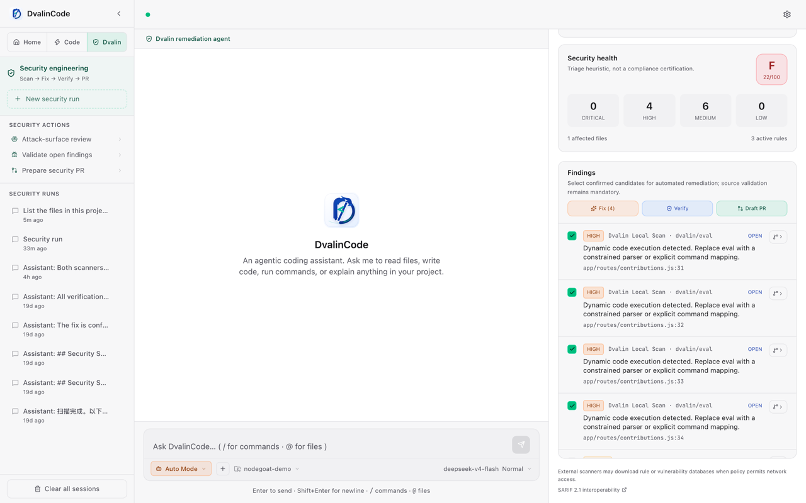
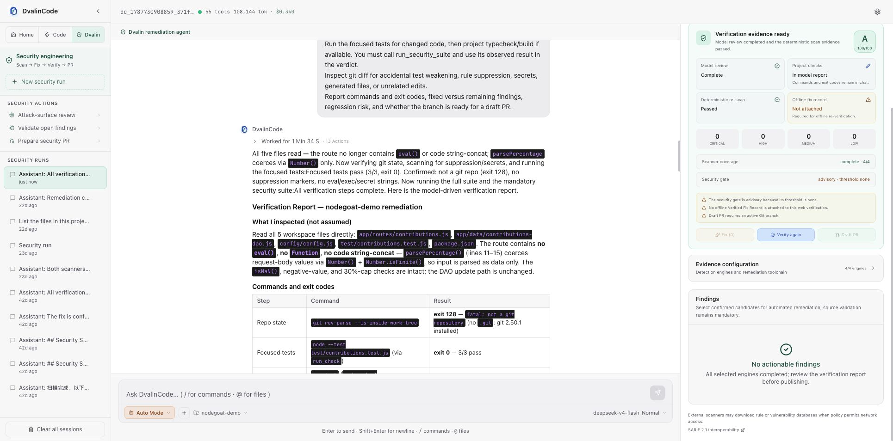
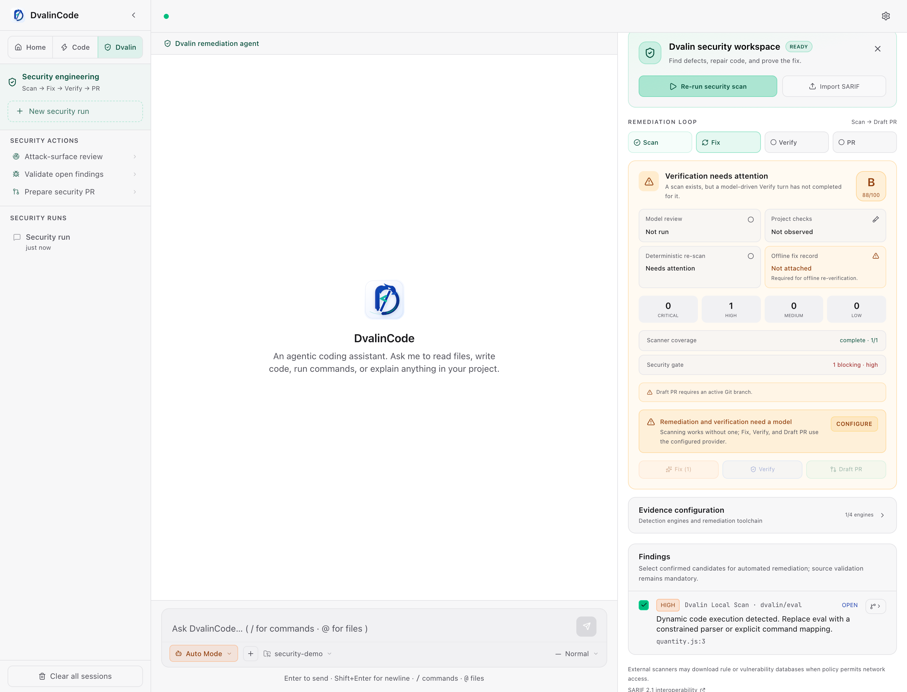
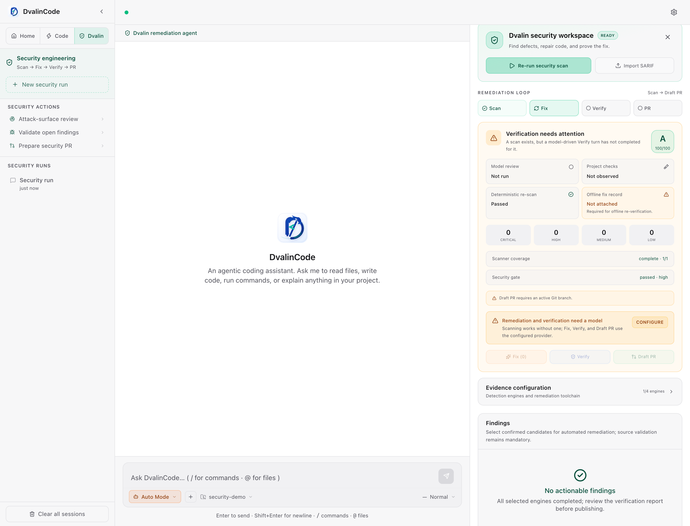
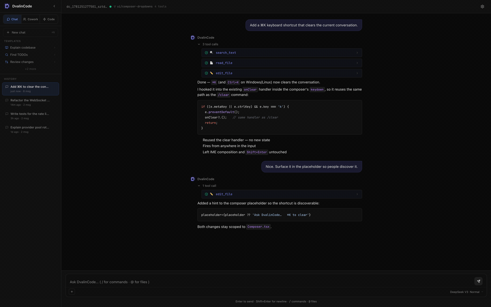

# DvalinCode desktop app

**English** · [中文](zh/gui.md)

The desktop app is DvalinCode in its own window: chat with the agent, read its
diffs, approve each change, and run the Dvalin security workspace (scan, fix,
re-verify) without a terminal. It runs on macOS and Windows, over the same
engine as the [CLI](cli.md): the same policy, approvals, audit trail and
verification. What both share is on two pages: [the built-in agent](agent.md) —
modes, tools, providers, the architecture and the FAQ — and
[trust and governance](trust.md).

## 🚀 Install

### macOS

```sh
curl -fsSL https://raw.githubusercontent.com/arthurpanhku/dvalincode/main/scripts/install.sh | bash -s -- --gui
```

This puts **DvalinCode.app** into `/Applications` (or `~/Applications` when
`/Applications` is not writable) and touches nothing else, so it launches
straight from Launchpad. To pin a version, run
`curl -fsSL …/install.sh | DVALINCODE_GUI_VERSION=v0.26.0 bash -s -- --gui`.

### Windows

Download `dvalincode-gui-v*-windows-x64-setup.exe`
from the latest [Desktop GUI release](https://github.com/arthurpanhku/dvalincode/releases?q=gui-v)
and run it. It installs per-user under `%LocalAppData%\Programs\DvalinCode` —
no administrator and no UAC prompt — adds a Start menu entry, an optional
desktop shortcut and an uninstall entry, and installs the Microsoft Edge
WebView2 Runtime if your machine does not already have it. DvalinCode then
opens in its own window instead of a browser tab.

The setup executable is not yet Authenticode signed, so Windows SmartScreen
warns the first time you run it: choose **More info → Run anyway**. Verify the
download against `SHA256SUMS-gui.txt` if you would rather check it yourself.

### Manual download

Each [desktop release](https://github.com/arthurpanhku/dvalincode/releases?q=gui-v) carries:

| Platform | File |
|---|---|
| macOS Apple Silicon (M1/M2/M3) | `dvalincode-gui-v*-macos-arm64.tar.gz` — unpack it and drag `DvalinCode.app` into Applications |
| macOS Intel | `dvalincode-gui-v*-macos-x64.tar.gz` |
| Windows x64 | `dvalincode-gui-v*-windows-x64-setup.exe` (installer) or `dvalincode-gui-v*-windows-x64.zip` (no install) |

Verify against `SHA256SUMS-gui.txt`, included in each desktop release.

[Code signing policy](CODE-SIGNING.md) · [Privacy notice](PRIVACY.md).
SignPath Foundation signing is being prepared; it is not yet confirmed active.

> **macOS Gatekeeper:** the app is not yet signed with an Apple Developer ID, so a copy downloaded with a browser is quarantined. Clear it with `xattr -dr com.apple.quarantine /Applications/DvalinCode.app`; the one-line installer does this for you.

---

## 🎬 First launch

Open DvalinCode, then:

1. Open **Settings** (bottom of the sidebar) → **LLM Providers** → **Configure**.
2. Pick a provider, paste your API key, choose a model, hit **Save**.
3. Optional: save the current config as a named profile (e.g. `fast`, `cheap`, `local-ollama`) to switch quickly later.

Each launch starts the app's own local server and hands the window that server's access token, so there is no link to copy or keep private. Your config and sessions live in `~/.dvalincode/`, shared with the CLI.

---

## 📸 Preview

**A real Dvalin scan of vulnerable code — Security health 22/100 · F, with the
10 findings the engines actually reported, located to the line:**

<p align="center">
  
</p>

**The verified result — a real model-driven Verify turn inspected the repair,
ran the regression tests and all four open-source engines, then the deterministic
server re-scan reported complete coverage, a passing gate, 0 findings, 100/100 · A:**

<p align="center">
  
</p>

### Current Mac mini smoke test

On 2026-09-18, commit `d4bf02b` was built and run as the local app on an
Apple-silicon Mac mini with macOS 27.0. The disposable test project had no API
key or configured model, and selected only the network-independent built-in
scanner. Dvalin located a deliberately vulnerable `eval` at `quantity.js:3`,
reported **1 high finding, 88/100 · B**, recorded complete **1/1** selected-engine
coverage, and blocked the `high` security gate:

<p align="center">
  
</p>

After replacing `eval` with a constrained integer parser and adding an
executable-input regression test, all **3/3** tests passed. The selected engine
then reported **0 findings, 100/100 · A**, complete coverage, and a passing gate:

<p align="center">
  
</p>

The same CLI workflow ran `npm run test` with exit code 0, issued a
`dvalin-fix-record/v2`, and `dvalin verify-fix` re-derived it offline with
`ok: true`. The clean-scan screenshot was captured before that record was
imported, so it still says **Offline fix record: Not attached**. The Web workspace
can now import the portable JSON record, re-derive its hash and verdict offline,
and display its executor, checks, and exit codes. A clean scan is evidence about
the selected engine, not a claim that the code is proven safe.

**Home → Code → Dvalin — the current workspaces:**

<p align="center">
  
</p>

The scan images above are unedited captures of a real run against the documented
NodeGoat-derived case: the scanners were run, the model repaired the source, the
project's tests were run, and the tree was re-scanned. Nothing is staged, and a
100/A means the configured engines found nothing — not that the code is proven
safe.

---

## 🔄 Staying up to date

The macOS desktop app checks the separate `gui-v*` release track when it starts.
When a newer GUI is available, it asks before downloading, verifies the archive
against `SHA256SUMS-gui.txt`, validates the app version, then replaces and
restarts `DvalinCode.app`. A failed replacement rolls back to the previous app.

On Windows, run the newer `dvalincode-gui-v*-windows-x64-setup.exe`: it upgrades the installed app in place.
