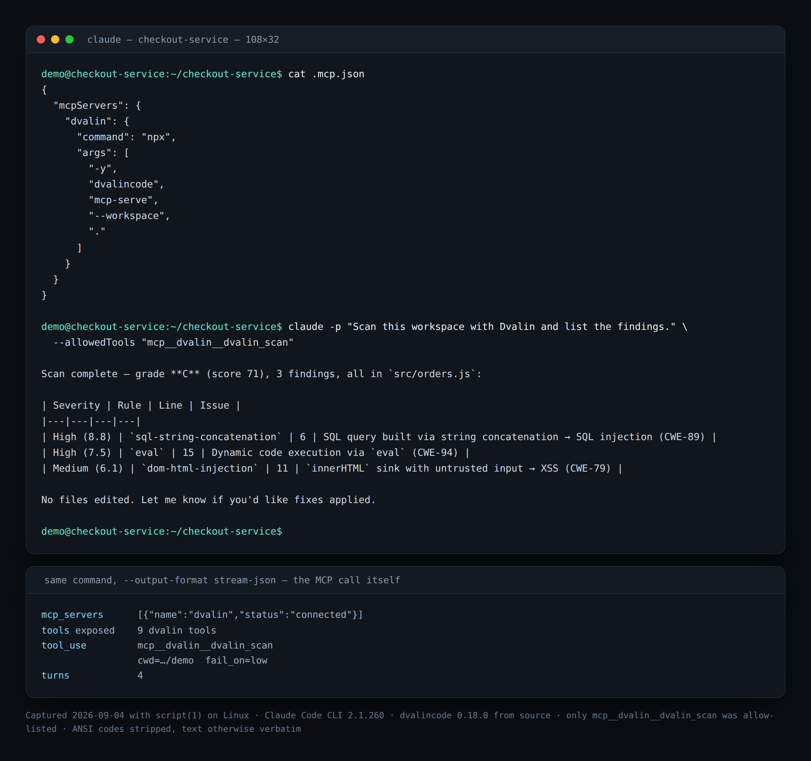
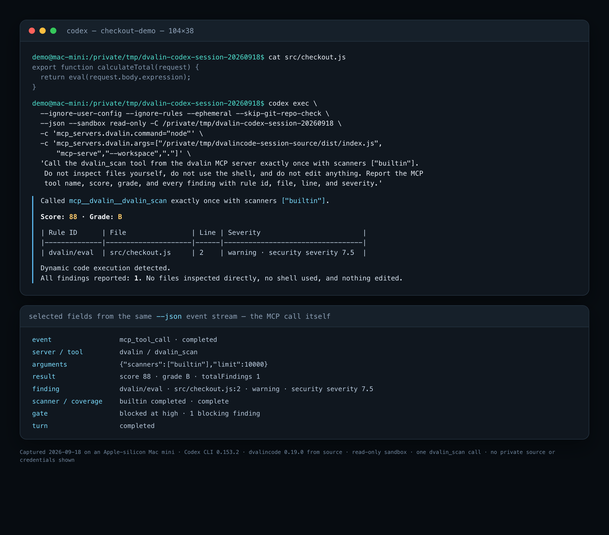
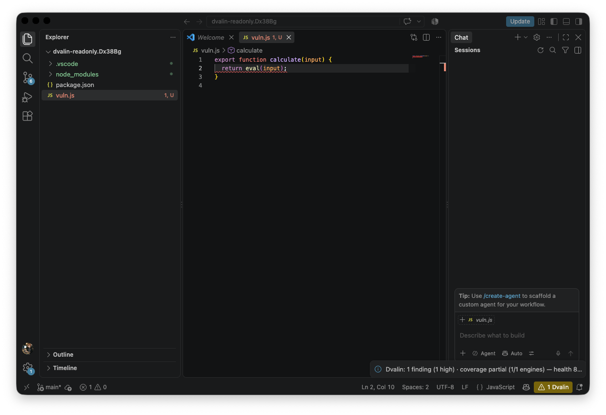

# DvalinCode CLI

[English](../cli.md) · **中文**

CLI 是面向终端与自动化的 DvalinCode：交互式终端 Agent、Dvalin 安全扫描器、供 CI
和定时任务使用的无头运行，以及给你已经在用的编码 Agent 调用的 MCP 服务。它支持
macOS、Linux 和 Windows。[桌面应用](gui.md)是另一个产品：同一个引擎，放在窗口里。
两者共享的内容分在两页：[内置 Agent](agent.md)（模式、工具、Provider、架构、常见问题）和[信任与治理](trust.md)。

## 🚀 安装

### Homebrew（macOS / Linux）

```sh
brew tap arthurpanhku/dvalincode https://github.com/arthurpanhku/dvalincode
brew install arthurpanhku/dvalincode/dvalincode
```

安装的是和一行命令同一份、按校验和固定的发布归档，之后 `brew upgrade` 即可保持更新。
Homebrew 不会给文件打上 macOS 隔离属性，所以这条路径不受 Gatekeeper 干预。

### 一行安装（macOS / Linux）

```sh
curl -fsSL https://raw.githubusercontent.com/arthurpanhku/dvalincode/main/scripts/install.sh | bash
```

自动检测系统和架构、下载对应二进制、安装到 `~/.dvalincode/`、添加到 `PATH`。它只装
CLI；桌面应用[单独安装](gui.md)。

装好 CLI 后，重新加载 shell：

```sh
source ~/.zshrc    # 或 ~/.bashrc
dvalincode                       # 交互式终端代理
dvalincode dvalin .              # 白盒安全扫描
dvalincode dvalin . --fix --verify --draft-pr  # 隔离修复、验证并创建草稿 PR
dvalincode serve                 # 启动 Web GUI 并打开浏览器
dvalincode serve --host 0.0.0.0 --no-open   # 部署到服务器；打开打印出的 ?token= 链接
echo "检查 src 并总结" | dvalincode run - --output-format stream-json
dvalincode mcp-serve             # 供外部 Agent 调用的任务级 stdio MCP 服务
```

### Windows

从 [Releases](https://github.com/arthurpanhku/dvalincode/releases/latest)
下载 `dvalincode-v*-windows-x64.zip` 并解压。在终端里运行 `dvalincode-windows-x64.exe`
进入终端 Agent，运行 `dvalincode-windows-x64.exe serve` 启动 Web GUI；`web\dist`
要和 `.exe` 放在同一目录。

### 手动下载

从 [Releases 页面](https://github.com/arthurpanhku/dvalincode/releases/latest) 获取对应平台的压缩包：

| 平台 | 文件 |
|---|---|
| macOS Apple Silicon (M1/M2/M3) | `dvalincode-v*-macos-arm64.tar.gz` |
| macOS Intel | `dvalincode-v*-macos-x64.tar.gz` |
| Windows x64 | `dvalincode-v*-windows-x64.zip` |
| Linux ARM64 | `dvalincode-v*-linux-arm64.tar.gz` |
| Linux x64 | `dvalincode-v*-linux-x64.tar.gz` |

每个 release 都附带 `SHA256SUMS.txt` 用于校验。

每个 release 还附带 **`dvalincode-v*-evidence.json`** —— 由发布出去的那个二进制在构建机上给自己生成的
Evidence Pack：两次真实的受治理运行（一次放行、一次被策略拦截）及其哈希链。安装之前就可以自己核验本页的说法：

```sh
dvalincode evidence verify dvalincode-v0.14.0-evidence.json   # 离线，只读这一个文件
```

该文件的校验和写在 `SHA256SUMS.txt` 里，而 `SHA256SUMS.txt` 正是 release 构建溯源签名（build provenance
attestation）的签署对象。[生成方式 →](../RELEASE-EVIDENCE.md)

> **macOS Gatekeeper：** 二进制未签名。首次运行可执行 `xattr -dr com.apple.quarantine ~/.dvalincode`，或在 Finder 中右键 → 打开一次。

---

## 🎬 首次运行

运行 `dvalincode`。首次启动会引导你完成一次性的 Provider 配置（选择 Provider、粘贴 API Key、选择模型），保存到 `~/.dvalincode/config.json`。随后即进入对话提示符 —— 直接输入即可对话，`/mode` 在 Chat / Cowork / Code / Dvalin 之间切换，`/help` 查看命令。在 GUI 中，Chat 和 Cowork 合为 **Chat** 工作区，就是输入框模式菜单里的 Ask 和 Collaborate。

配置和 Session 都保存在 `~/.dvalincode/`，与 `dvalincode serve` 和桌面应用共用。

---

## ⏱️ 30 秒，免安装，不需要 API Key

```sh
npx dvalincode security scan .
# 安装 npm 包后也可直接运行：dvalin scan .
```

就这一条。它用内置规则扫描当前目录里的注入、硬编码密钥、XSS、`eval` 和不安全的
shell 调用，然后把结果打出来。不需要注册、不需要模型、不需要配置，代码不出本机。
默认只启用一定存在的 Dvalin Built-in；可选引擎必须显式启用，其固定安装命令可以先审查：

```sh
dvalin scanners list
dvalin scanners install semgrep       # 只显示并审查命令
dvalin scanners install semgrep --yes # 在 Dvalin 策略约束下执行
```

### 一步变成门禁

```sh
dvalin init
```

`init` 会写入 `dvalin.security.json`（只对 high 及以上的*新增* finding 失败），把项目里真实存在的检查
（`test`、`typecheck`、`build`、`lint`）登记为 Dvalin 判定修复前要亲自运行的检查，把当前已有的
finding 记录为可接受的存量（`.dvalin/baseline.json`），并为 GitHub（`.github/workflows/dvalin.yml`）
或 GitLab（`.gitlab/dvalin-security.yml`，附带 MR 面板用的 Code Quality 报告）写好 CI 门禁。
已存在的文件不会被覆盖，除非加 `--force`。把它写出的文件提交上去，存量问题就不会再挡住任何人：
只有改动新增的问题才会失败。

想在本地每次提交前也把关，加上 [pre-commit](https://pre-commit.com) hook：

```yaml
# .pre-commit-config.yaml
repos:
  - repo: https://github.com/arthurpanhku/dvalincode
    rev: v0.24.0          # hook 自 v0.22.0 起提供
    hooks:
      - id: dvalin-scan   # PATH 上已有 dvalin 时用 dvalin-scan-installed
```

### 用 CI 门禁同一把尺子来验证

如果卡你合并的是 Snyk，就用 Snyk 来验证。用别的引擎判定"干净"的修复，推上去照样可能被门禁拒绝 ——
一次 agent 修复变成"推送、失败、rebase"反复好几轮，往往就是因为两边尺子不一样。

```sh
npm install -g snyk && snyk auth      # 或设置 SNYK_TOKEN
dvalin scan . --scanners builtin,snyk-code,snyk-oss
```

`snyk-code`（SAST）和 `snyk-oss`（依赖）与其他引擎完全同等：同样的指纹、覆盖度和门禁；
登录失败会作为引擎错误上报，扫描结果是 `partial`，绝不会显示成干净。它们只在被显式点名时运行，
因为 Snyk Code 会把源码上传到 Snyk。把它们写进 `dvalin.security.json` 就成为策略的一部分，
`reverify` 也会用它们评判每一次修复。

如果卡合并的是 GitHub code scanning，就同样用 CodeQL：

```sh
dvalin scan . --scanners builtin,codeql
```

`codeql` 会在 workspace 之外为每种语言建一个数据库，并跑该语言默认的 code-scanning 查询集，
所以它报的就是门禁会报的问题。JavaScript/TypeScript、Python、Ruby、Java、C# 无需构建即可分析；
Go 使用 CodeQL 的 autobuild。Kotlin、C/C++、Swift 需要项目自己的构建，树里有它们时运行结果会如实说明，
扫描是 `partial` 而不是干净。它只在被点名时运行 —— 建库要几分钟而不是几秒，而且 CodeQL CLI
的许可只覆盖开源代码和 GitHub Advanced Security 客户。

Snyk 自己标记为已接受的忽略会被尊重，并列入覆盖度的排除项。但**被审查的这次改动新增的**忽略不算数：
评判修复时，`.snyk`、`.semgrepignore`、`.trivyignore`、`.dvalincodeignore` 会恢复成 base 版本，
新增的行内标记（`deepcode ignore`、`nosemgrep`、`nosec`、`NOSONAR` 等）会被抹掉 ——
被"静音"而不是被修复的问题仍然会让这次修复失败。忽略是人在单独变更里做的风险决定，从来不是修复。

凡是 Dvalin 说"已验证"的地方，判定标准都一样：修复循环、`dvalin verify`、MCP 的 `dvalin_verify_findings`、
单轮 `--fix --verify`，以及 CI 的 `reverify`。这些入口签发的是 `dvalin-fix-record/v3` 记录，
它还会拒绝"把问题藏起来而不是修掉"的改动 —— 换成同类危险调用、删掉有漏洞的文件、删测试或删断言。
在非 git 仓库中无法确定改动范围，记录保持 v2，并写明未评估规避。

### 让它一直修到门禁会通过为止

```sh
dvalincode dvalin . --scanners builtin,snyk-code,snyk-oss --until-clean --max-rounds 3 --executor codex
```

`--until-clean` 把一次修复变成有上限的循环：执行器改代码，Dvalin 用同样的引擎重新扫描、亲自跑项目检查，
然后**只把还没解决的部分**发回给执行器 —— 仍存在的目标、它的改动新引入的问题、失败的检查及其最后几行输出、
它新增的忽略 —— 让它再修一轮。依赖漏洞优先处理。

循环会在以下情况停下并说明原因：所有目标消失、没有新引入阻断问题、检查全部通过（`verified`）；轮数用完；
某一轮留下完全相同的问题、或问题集合不再缩小（`stalled`）；目标需要人处理，比如依赖没有可修复版本
（`not-auto-fixable`）；引擎或检查跑不起来（`unverifiable`）。执行器新增的忽略会在每次扫描前被撤销，
并且在被删除之前一直算作未解决的问题。每种结局都会签发修复记录，每一轮都记录在
`~/.dvalincode/security/fix-loops/` 下。

每一轮会尽量短，但判定方式不变。各扫描引擎并行运行，一次扫描的耗时取决于最慢的引擎，而不是所有引擎之和。
在两轮之间，逐文件分析的引擎（Dvalin Built-in、Semgrep）只重扫本次改动的文件和目标所在的文件，
其他引擎始终扫描整个目录树。这种缩小范围的扫描只用于给执行器反馈：任何会让循环停下的一轮，
都会在同一棵树上用全量扫描重新判定，最终结论和修复记录只来自全量扫描。
`--full-rescan` 让每一轮都做全量扫描；`dvalin loop-stats` 会报告每轮扫描耗时，以及全量扫描改变判定的次数。

对**代码类**问题，循环会先要求复现：执行器只写测试，Dvalin 在未修复的代码上运行，并要求它失败 ——
必须是断言失败，而不是测试运行器缺失、或引用了还没写的函数。测试文件会被记录哈希；修复必须让它们在
**不被改动**的前提下通过，这次运行会作为一项检查写进记录。如果没有任何测试能复现，循环在动手修之前就以
`not-reproduced` 停下：这可能是误报，交给人来判断。测试运行器自动推断（vitest、jest、mocha、`node --test`、
pytest、`go test`），也可以用 `--repro-command 'npx vitest run {files}'` 或 `dvalin.security.json` 里的
`reproduce` 指定 —— 永远不由执行器选择。

每一轮修复还会拒绝 agent 在"让扫描器闭嘴"目标下常用的规避手法：把危险调用换成同类写法（`eval` →
`new Function`，`exec` → 带 `shell: true` 的 `spawn`）、删掉有漏洞的文件、删测试、删断言。
实际上第一种手法单靠扫描器是拦不住的 —— 规则不再匹配 —— 真正拦住它的是复现测试和规避检测。

### 始终基于最新的 main，并在 CI 里收尾

```sh
dvalincode dvalin . --scanners builtin,snyk-code,snyk-oss --until-clean \
  --rebase-onto origin/main --executor codex --draft-pr --sign-key ci.key
```

加上 `--rebase-onto` 后，循环会在开始前和每一轮之后拉取上游并把修复 rebase 上去，然后在新的 base 上评判。
冲突交给执行器 —— 只给冲突文件，并要求"不要运行 git" —— rebase 由 Dvalin 自己继续；文件里残留冲突标记就算没解决。
解决不了就中止 rebase，工作区恢复原样，循环以 `rebase-conflict` 停下。每次 rebase 后都会在新 base 上重新扫描建立基线，
队友合进 main 的问题不会被算到这次修复头上。

`--draft-pr` 会把记录提交到 `.dvalin/fix-record.json`，
[`docs/examples/dvalin-fix-loop.yml`](../examples/dvalin-fix-loop.yml) 在 PR 上用 `reverify: true` 重新执行：
重新扫描 base 和 head、重跑检查，并在原地还原修复后重跑复现测试（必须失败）、恢复后再跑（必须通过）—— 最后用 CI 密钥签名。

要建立“禁止新增高风险问题”的增量门禁，把策略和基线一并提交到仓库：

```sh
dvalin init
dvalin baseline
dvalin scan
```

这会创建 `dvalin.security.json` 和 `.dvalin/baseline.json`。每条 suppression 都必须
写原因，还可以设置 owner 和过期时间。扫描输出是版本化 envelope，包含确定性 gate
结果和可恢复的 workflow ID。

### 或者挂到每个 PR 上 —— 完全不用装任何东西

```yaml
# .github/workflows/security.yml
permissions:
  contents: read
  security-events: write
steps:
  - uses: actions/checkout@v5
    with:
      fetch-depth: 0        # 让扫描能取到 base commit
  - uses: arthurpanhku/dvalincode@v0.24.0
    with:
      fail-on: high
      diff: true            # 只报告这个 PR 改动的部分
```

扫描结果会直接标注在 PR 的 diff 上，同时进入仓库的 Security 页。不需要 API Key、
不需要任何 secret、不调用模型 —— 扫描是确定性的，且只在 runner 本地进行。
[完整示例 →](../examples/dvalin-scan.yml)

`diff: true` 只报告 PR 改动到的行，因此这道门禁拦的是这次改动**新引入**的问题，
而不是仓库里本来就有的一堆存量问题。这正是它能在一个并不干净的代码库上被接受的
原因。去掉它就是全仓库扫描。

每条评论都会在结论旁边写明这次扫描的**覆盖率** —— `complete` / `partial` /
`unknown`。因为「没发现问题」在半数引擎没装的情况下，和在完整扫描下，根本不是同一个
答案。

### 再把证明贴到 diff 旁边

如果你的流水线产出了 fix record，把它交给同一个 action：

```yaml
  - uses: arthurpanhku/dvalincode@v0.24.0
    with:
      fix-record: fix-record.json
```

runner 会仅凭这个文件本身重新推导它 —— 重算哈希，并从它自己的证据重新推出结论 ——
然后把结果发到 PR 上。一份签发之后被改过的记录会在这里失败，并让整个 job 失败。

重新推导只能证明记录**自洽**，证明不了它出自真正跑过验证的人：记录里的每个字段（包括退出码）
伪造者都能写出来，一份自洽的伪造记录照样能通过重新推导。要补上这个缺口，需要两件事 ——
在 runner 上重新执行这份声明，并对 runner 观察到的结果签名。

```
🔏 Verified Fix Record
✅ ce504a995395 · VERIFIED · scan-and-checks
- repaired by claude-code — recorded, and not consulted for this verdict
- targets: 1 before → 0 remaining
- coverage: complete → complete
- introduced: none (gate high/new)
- outcome: verified
- ✓ test: `npm run test` (exit 0)
- audit chain: verify-eeb1bae7 @ 80881867270d
```

引入了新问题的修复，会在同一个地方说清楚，并让这个 job 失败：

```
❌ 916e2eeaf065 · NOT VERIFIED · scan-and-checks
- introduced: 1 finding(s) the first scan did not report (gate high/new)
  - critical dvalin/sql-injection — src/db.ts:31
- outcome: regressed
```

### 在 runner 上重新执行，并对看到的结果签名

```yaml
  - uses: actions/checkout@v5
    with:
      fetch-depth: 0              # 需要能拿到 base commit
  - run: npm ci                   # 项目自己的检查会在 runner 上执行
  - uses: arthurpanhku/dvalincode@v0.24.0   # reverify 需要 v0.22.0 或更高版本
    with:
      fix-record: fix-record.json
      reverify: true
      signing-key: ${{ secrets.DVALIN_SIGNING_KEY }}   # 可选
```

开启 `reverify: true` 后，被声明的记录只提供两样东西：它说修了**哪些 target**，以及
**谁**是执行者。其余一切都重新观察：

- 检出并扫描 **base** commit，每个被声明的 target 必须真的在那里存在 —— 记录不能把
  "删掉一个从未存在的 finding" 算作功劳；
- 扫描 **head**，"已消失" 由 runner 亲眼观察；
- 在 runner 上运行项目检查，检查项、门禁和扫描器都读自 **base** commit 的
  `dvalin.security.json` —— 一个放宽自己门禁或删掉自己检查的 PR，仍按它想改掉的规则评判；
- 根据这些观察签发一份全新的记录，只有它判定通过，job 才通过。

提供 `signing-key` 时，新记录会被签名（Ed25519，签的是记录哈希）。私钥在项目检查运行前
就被读入内存并从环境变量中移除，被审查的代码读不到它。下游（发布 job、其他仓库、审计方）
就可以要求这个签名：

```sh
dvalin keygen --out ci                          # 只需一次；ci.key 存为 secret，ci.pub 公开
dvalin verify-fix record.json --trusted-key ci.pub
```

在 `--trusted-key` 下，未签名或只由你没指定的密钥签名的记录都会失败。有效签名只说明
**哪个密钥为这份记录背书**；是否信任这个密钥由你决定 —— 信任 CI 密钥的理由，是 CI job
亲自重新执行了验证，而不是照抄。本地可以用 `dvalin reverify <record> --base origin/main`
做同样的重新执行，用 `dvalin sign-fix` 给一份能重新推导的记录签名。
[FVP-1 §4a、§5a →](../spec/FIX-VERIFICATION.md)

### 或者让你的 agent 调用它

如果代码是 agent 写的，那检查它的就不能是同一个 agent。DvalinCode 本身是个 MCP
server，任何支持 MCP 的 agent 都能接：

```sh
claude mcp add dvalin -- npx -y dvalincode mcp-serve --workspace .
```

一条命令配好你实际在用的编辑器：

```sh
npx dvalincode mcp-install codex         # 通过 `codex mcp add` 更新 ~/.codex/config.toml
npx dvalincode mcp-install cursor        # .cursor/mcp.json
npx dvalincode mcp-install vscode        # .vscode/mcp.json
npx dvalincode mcp-install claude-code   # .mcp.json
npx dvalincode mcp-install gemini        # .gemini/settings.json
npx dvalincode mcp-install opencode      # opencode.json
```

对于 Codex，Dvalin 会委托官方 `codex mcp add` 命令安全更新 TOML，无需手改用户配置。
其他客户端的格式也不一样，而且写错不会报错——VS Code 的 key 是 `servers`，Cursor 是
`mcpServers`，填反了编辑器会照单全收然后当没看见。这条命令会写对，并且合并进已有
配置而不是覆盖。[编辑器与 MCP →](../../integrations/mcp/)

也可以让 Dvalin 自己去找。`agents` 列出这台机器上装了哪些 coding agent，以及哪些已经
接入 Dvalin；`agents connect` 给剩下的列出接入计划，不加 `--yes` 就什么都不写：

```sh
npx dvalincode agents                 # 装了哪些 agent，哪些已经接入 Dvalin
npx dvalincode agents connect         # 接入计划：每个 agent 会写什么
npx dvalincode agents connect --yes   # 执行
```

如果你用 [CC Switch](https://github.com/farion1231/cc-switch) 管理 MCP server，
`agents connect cc-switch --yes` 会把 Dvalin 交给它：CC Switch 先展示导入内容、征得你
确认，再把 Dvalin 同步进 Claude Code、Codex、Gemini CLI 和 OpenCode。

`dvalin_scan` 支持 `diff: "uncommitted"`，只报告 agent 刚写的部分，而不是仓库里的全部存量问题。它不跑模型、不修改目标 workspace、也不持久化 Dvalin 状态，因此客户端可以默认允许这次预览。确认要修复某条发现后，Agent 再显式调用
`dvalin_begin_verification` 创建精简的本地安全 workflow，用 fingerprint 精确读取单条发现，再通过 `dvalin_get_finding` 和
`dvalin_verify_findings` 请求独立复扫。响应包含 MCP `structuredContent`，并可通过
`dvalin_list_scanners` 查询组件是否就绪。同一 server 也提供可选的 `dvalin_run_task`
实现助手，以及 session 和审计证据工具。

下面每一个客户端都被驱动到了真实的工具调用，而不只是握手成功 —— 具体是哪个客户端、
哪个版本、哪一天验的，写成了表格而不是一句话，因为手写的版本号会悄无声息地过期。
[集成支持 ↓](#-集成支持) · [Agent 集成 →](../../integrations/)

仓库还提供一份 [Codex/Claude 可移植插件](../../integrations/dvalin-security/)：包含当前根目录
Agent Plugins manifest、兼容 manifest、共享安全门禁 skill 和 Claude 兼容 MCP 配置。
仓库内 marketplace 让 Codex desktop 可以直接发现它；安装后，agent 可根据任务
上下文自动发现门禁，不再依赖每位开发者记住扫描提示词。Codex 的 MCP server 由
`mcp-install codex` 单独绑定到当前项目，避免插件进程误扫自身的安装缓存目录。
Codex 会采纳扫描工具的只读 MCP 标注；Claude Code 按其安全设计仍需显式授权一次。
插件给出精确到只读扫描工具的 allow 规则，不要求用户绕过所有权限。

### 你在哪儿干活，它就在哪儿

同一个 server，按每个工具各自的方式接进去：

| Harness | 怎么接 |
|---|---|
| **Claude Code** | [可移植插件](../../integrations/dvalin-security/)，或 `claude mcp add` · [独立 skill](../../integrations/claude-code/) |
| **Codex** | `dvalincode mcp-install codex` · [可移植插件](../../integrations/dvalin-security/) · 与 Codex Security 的 [密封扫描 + SARIF 互操作](../../integrations/codex-security/) |
| **Cursor** | `dvalincode mcp-install cursor` |
| **VS Code** | `dvalincode mcp-install vscode` · 在 Problems、coverage/gate 状态和离线 VFR 校验中展示结果的[扩展](../../editors/vscode/) —— *已构建，尚未发布* |
| **Gemini CLI** | `dvalincode mcp-install gemini` |
| **OpenCode** | `dvalincode mcp-install opencode` |
| **CC Switch** | `dvalin agents connect cc-switch` —— 导入一次，同步进 CC Switch 管理的每个 agent |
| **Windsurf · Zed** | 在各自设置里配 stdio MCP —— [server 命令](../../integrations/mcp/) |
| **任意 MCP 客户端** | [MCP registry](https://registry.modelcontextprotocol.io/)：`io.github.arthurpanhku/dvalincode` |
| **GitHub Actions** | [Marketplace action](https://github.com/marketplace/actions/dvalin-security-scan) —— 结果直接标在 PR diff 上 |
| **GitLab CI** | `dvalin init --ci gitlab` —— 新增 finding 卡住 MR，并显示在 Code Quality 面板里 |
| **pre-commit** | [`dvalin-scan` hook](../../.pre-commit-hooks.yaml) —— 每次提交前跑同一套策略门禁 |
| **任意 CI** | `dvalin scan . --fail-on high`，输出 SARIF 供 code scanning 用 |

各家的 MCP 配置格式并不通用——Codex 通过自己的 CLI 管理 TOML，VS Code 的 key 是
`servers`，Cursor 是 `mcpServers`，OpenCode 是 `mcp` 且整条命令写在一个数组里，
填错了不会报错只会静默失效——所以 `mcp-install` 会写对格式，并合并进已有配置。
[编辑器与 MCP →](../../integrations/mcp/)

### 或者和 Codex Security 互操作

[Codex Security](https://github.com/openai/codex-security) 会为已完成扫描保存 manifest、
结构化 findings 与 coverage。Dvalin 只读取这些可移植工件，不耦合其私有应用状态：

```sh
DVALIN_CODEX_SCAN_DIR=/tmp/codex-security-results
npx @openai/codex-security scan . --output-dir "$DVALIN_CODEX_SCAN_DIR"
dvalin import "$DVALIN_CODEX_SCAN_DIR" .
dvalin scan . --fail-on high
```

导入会校验 manifest 记录的工件哈希、生成稳定的 remediation case，并把排除项和延期
工作明确报告为 complete、partial 或 unknown coverage；`--no-persist` 可以只校验交接件
而不修改 backlog。SARIF 继续作为只包含 findings 的兼容路径。
[集成指南 →](../../integrations/codex-security/)

### 然后让它把找到的问题修掉

```sh
dvalincode dvalin . --fix --verify --draft-pr
```

这一步**才**会用到模型 —— 你自己的模型，任何 OpenAI 兼容端点。它在隔离的 worktree
里准备聚焦修复，运行你的测试，并且必须通过一次干净的复扫，才允许进入 Draft PR。
它不会自动合并，也不会把「扫描干净」当成「代码安全」的证明。

[README](../../README.zh-CN.md) 用一个改编自 NodeGoat 的例子，把这样一次运行逐项量给你看。

---

## 🧩 集成支持

AI 协助写出来的代码，在合并之前会经过四道手：写它的 agent、开发者读它的编辑器、
拦它的 Pull Request，以及最后必须相信这个结论的评审者。一个只存在于其中一处的安全
结论不是门禁，只是一条下一环节可以无视的建议。

Dvalin 在这四处背后是同一个 MCP server、同一次确定性扫描 —— 所以答案不会因为谁在问
而改变。

| 开发环节 | 你在哪儿 | Dvalin 怎么接进去 | 状态 |
|---|---|---|---|
| **写代码** | Claude Code | [可移植插件](../../integrations/dvalin-security/) · `claude mcp add` · `mcp-install claude-code` | ✅ 会话已验证 |
| | Codex | `mcp-install codex` · [可移植插件](../../integrations/dvalin-security/) · [密封扫描 + SARIF 互操作](../../integrations/codex-security/) | ✅ 会话已验证 · 见下方截图 |
| | Cursor | `dvalincode mcp-install cursor` | ⚙️ 配置已验证 |
| | Gemini CLI · OpenCode | `mcp-install gemini\|opencode` · `dvalin agents connect` | ⚙️ 配置已验证 |
| | CC Switch | `dvalin agents connect cc-switch` | ⚙️ 链接格式已测试，尚未实际导入 |
| | Windsurf · Zed | 通过它们自己的设置接 stdio MCP | ⚙️ 已文档化，未验证 |
| | 任意 MCP 客户端 | registry `io.github.arthurpanhku/dvalincode` | ⚙️ 已发布 |
| **回头读代码** | VS Code | `mcp-install vscode` · [扩展](../../editors/vscode/)：Problems、覆盖度与门禁状态 | ✅ 编辑器内已验证 |
| **卡住合并** | GitHub Actions | [Marketplace action](https://github.com/marketplace/actions/dvalin-security-scan) —— finding 落在 diff 上，fix record 在 runner 上重新推导 | ✅ 本仓库自己的 CI 就在跑 |
| | 任意 CI | `dvalin scan . --fail-on high`，输出 SARIF | ✅ 退出码就是契约 |
| **相信这个结论** | 任何人，离线 | `dvalin verify-fix record.json --trusted-key ci.pub` | ✅ 不需要 workspace、网络或任何 Dvalin 状态 |
| | 合并门禁 | `reverify: true` —— base 与 head 重新扫描、检查在 runner 上重跑、新记录签名 | ✅ 有测试覆盖 |

**✅** 表示真实客户端被端到端驱动过，并且观察到了工具调用。
**⚙️** 表示配置能生成、格式经过测试，但还没有抓到会话记录。这个区别这里不含糊过去 ——
一个能被加载的配置文件，不能证明工具真的被调用过。

### 每一条结论的依据

| 客户端 | 版本 | 检查时间 | 怎么检查的 |
|---|---|---|---|
| Claude Code | CLI 2.1.260 | 2026-09-04 | server 连上，只放行 `dvalin_scan` 一个工具并被真实调用，返回 3 条 finding —— 见下方截图 |
| Claude Code | CLI 2.1.251 | 2026-08-31 | 每周的 [`harness-interop`](../../.github/workflows/harness-interop.yml)：对构建产物做真实握手，这一步不需要任何凭据 |
| Codex | CLI 0.153.2 | 2026-09-18 | 在临时只读沙箱中真实调用 `dvalin_scan`；完成的 MCP 事件以 JSONL 记录，返回 1 条 `dvalin/eval` finding —— 见下方截图 |
| Codex | CLI 0.151.0 | 2026-08-31 | 每周的 `harness-interop`：server 配置被接受并按 stdio 存下。**这不是握手** —— 在设置 `CODEX_API_KEY` 之前，调用工具那一步一直是 skipped |
| VS Code | 1.134.0 · 扩展 0.18.0 | 2026-09-03 | 干净 profile 里安装打包好的 VSIX；finding、门禁和覆盖度都出现在编辑器里 —— 见下方截图 |
| Cursor | — | 2026-09-04 | `mcp-install cursor` 会把 `.cursor/mcp.json` 写成 `mcpServers` 结构；但还没有抓到会话记录 |
| Gemini CLI · OpenCode | — | 2026-11-11 | `mcp-install` 按它们自己文档规定的结构写入（Gemini：`settings.json` 里的 `mcpServers`；OpenCode：V1 的 `mcp` 条目，V2 仍然读取）；还没有抓到会话记录 |
| CC Switch | — | 2026-11-11 | `ccswitch://` 链接按 CC Switch 的 deep link 指南和导入器源码生成；还没有在运行中的 CC Switch 里实际打开过 |

那个每周任务之所以存在，是因为这段话的早期版本手写了两个 CLI 版本号，两个都在几周内
过期，而没有任何东西提醒过。现在它每周对着这些工具的当周版本重跑一次 —— 上面这些日期
要么自己往前走，要么就公开地停在那里。

### 同一条 finding，在不同的地方

**Claude Code** —— 只放行了一个只读工具，以及那次 MCP 调用本身：



**Codex** —— 一次只读 MCP 调用，并单独展示完成态的 JSONL 工具事件：



**VS Code** —— 同一套扫描器契约，变成波浪线和状态栏：



---

## 🤖 无头运行

无头 `run` 和 `mcp-serve` 与交互客户端共用同一个策略与审计关卡。cron、CI
和外部 Agent 示例见[无人值守配方](../RECIPES-UNATTENDED.md)。

扫描过、或者产出过 fix record 的运行，还会在结果旁边带上一份 `verification` 信封 ——
`json`、`stream-json` 以及 MCP `dvalin_run_task` 的返回里都有。`coverageStatus` 取的
是这次运行**有证据支持的最弱**覆盖度，因此一次完整扫描不能替一次部分扫描背书；产出
的记录按路径列出，可离线复验。CI 门禁可以直接读它：

```sh
jq -e '.verification.coverageStatus == "complete"' run.json || exit 1
```

这和 PR 评论用的是同一条规则，只是用在没有人盯着的那个界面上。
[Harness 模式 →](../HARNESS-MODE.md)

---

## 🌐 在浏览器里使用、远程访问的 Web GUI

`dvalincode serve` 在浏览器里提供和桌面应用相同的界面 —— 可以在本机用，也可以部署
到服务器上远程访问。

1. 服务在 `http://localhost:3000` 启动，并用它打印出的链接自动打开浏览器。
2. 打开侧边栏底部的 **Settings** → **LLM Providers** → **Configure**。
3. 选择 Provider、粘贴 API Key、选择模型、保存。
4. 可选：将当前配置保存为命名 Profile（如 `fast`、`cheap`、`local-ollama`），日后一键切换。

**访问令牌：** 服务端驱动的 Agent 能改文件、跑命令，所以没有访问令牌的 `/api` 和 `/ws` 请求一律拒绝。每次启动都会生成新令牌，放在打印出的启动链接里（`http://localhost:3000/?token=…`），页面会把它换成 HttpOnly cookie。这个链接请勿外传。没有令牌的浏览器会看到解锁页，可以粘贴链接或令牌；脚本用 `Authorization: Bearer <token>`。设置 `DVALINCODE_SERVER_TOKEN`（至少 16 个字符，仅限 `A–Z a–z 0–9 - _`）可在重启后沿用同一令牌。桌面应用会自动处理令牌。若要从另一台机器使用 GUI（`--host 0.0.0.0`），还需把 `DVALINCODE_ALLOWED_ORIGINS` 设为你在浏览器中打开的地址。

---

## 🔄 保持更新

DvalinCode 可自我更新，无需重新运行安装脚本：

```sh
dvalincode update --check   # 检查是否有新版本（只读）
dvalincode update           # 下载、校验并安装最新版本
```

它会在 GitHub 上找到最新 release；对二进制安装，会下载对应平台的归档，**在替换任何文件之前先用 release 的 `SHA256SUMS.txt` 校验**，然后就地替换 `~/.dvalincode/`。npm 安装通过 `npm i -g` 更新，源码检出则提示 `git pull`。可用 `-y` 跳过确认、`--prerelease` 跟踪预发布、`--json` 用于脚本。
