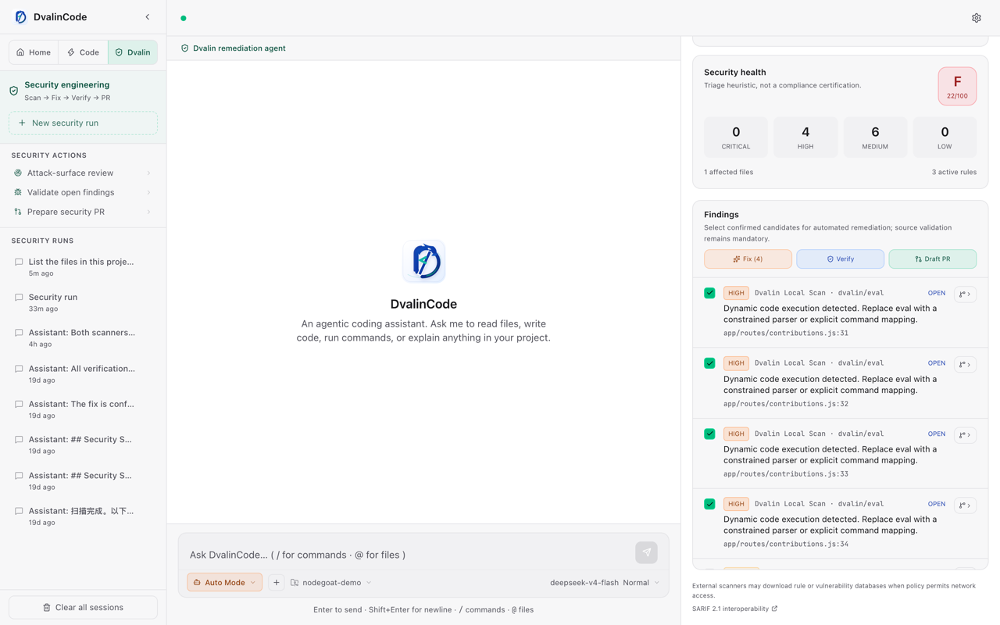
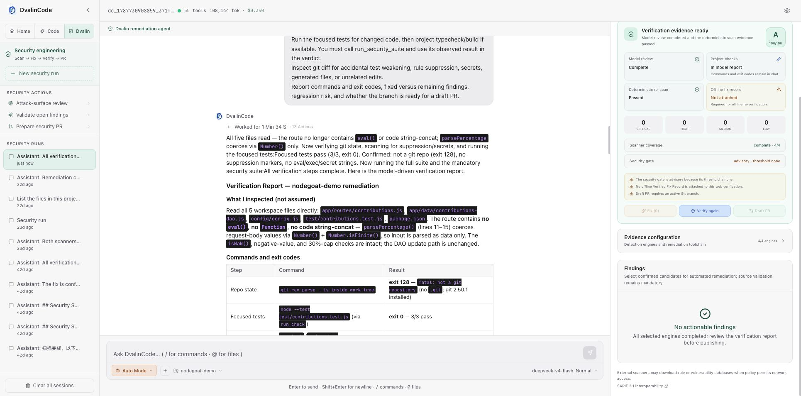
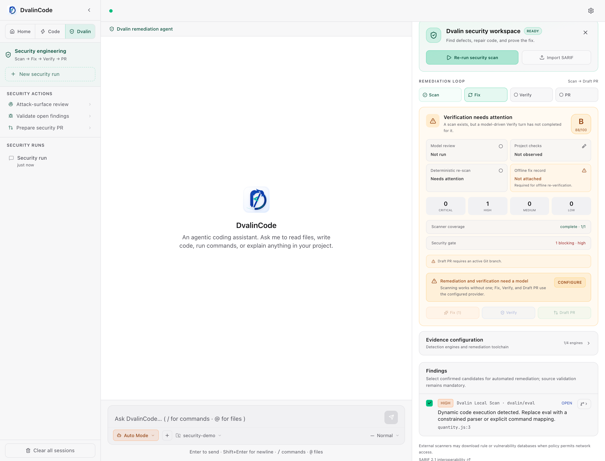
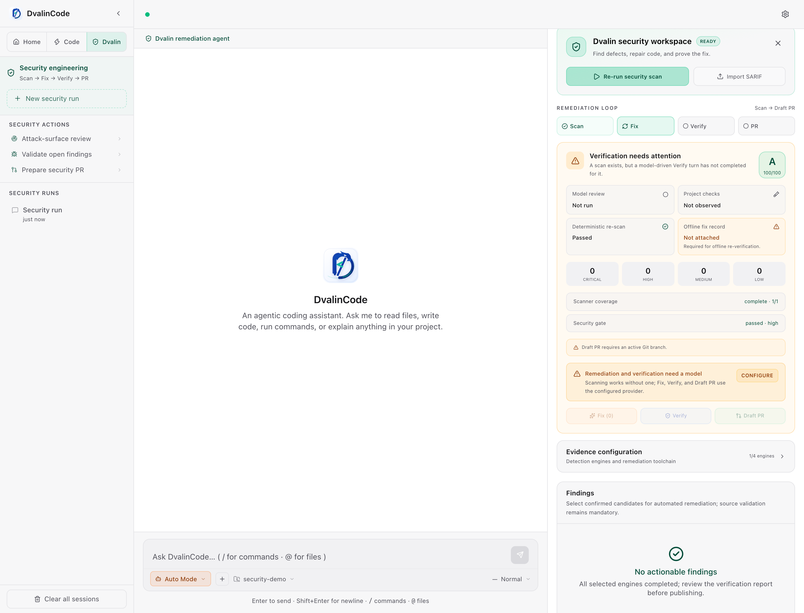
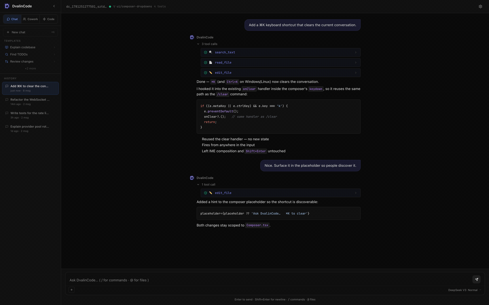

# DvalinCode 桌面应用

[English](../gui.md) · **中文**

桌面应用就是放在独立窗口里的 DvalinCode：和 Agent 对话、看它的 diff、逐个审批改动，
以及使用 Dvalin 安全工作区（扫描、修复、复验），全程不需要终端。它支持 macOS 和
Windows，底下和 [CLI](cli.md) 是同一个引擎：同样的策略、审批、审计链和验证。两者
共享的内容分在两页：[内置 Agent](agent.md)（模式、工具、Provider、架构、常见问题）和[信任与治理](trust.md)。

## 🚀 安装

### macOS

```sh
curl -fsSL https://raw.githubusercontent.com/arthurpanhku/dvalincode/main/scripts/install.sh | bash -s -- --gui
```

这条命令只会把 **DvalinCode.app** 装进 `/Applications`（不可写时改装到
`~/Applications`），不动其他任何东西，装完即可从启动台打开。要固定版本，运行
`curl -fsSL …/install.sh | DVALINCODE_GUI_VERSION=v0.26.0 bash -s -- --gui`。

### Windows

从最新的 [Desktop GUI 版本](https://github.com/arthurpanhku/dvalincode/releases?q=gui-v)
下载 `dvalincode-gui-v*-windows-x64-setup.exe` 并运行。它按用户安装到
`%LocalAppData%\Programs\DvalinCode` —— 不需要管理员权限，也不会弹 UAC ——
并创建开始菜单项、可选的桌面快捷方式和卸载项；若系统没有 Microsoft Edge
WebView2 Runtime，安装器会一并装上。之后 DvalinCode 在自己的窗口里打开，
不再是浏览器标签页。

安装包目前还没有 Authenticode 签名，所以首次运行会被 Windows SmartScreen
拦下：选择**更多信息 → 仍要运行**。也可以用 `SHA256SUMS-gui.txt` 自行校验下载。

### 手动下载

每个[桌面版发布](https://github.com/arthurpanhku/dvalincode/releases?q=gui-v)都附带：

| 平台 | 文件 |
|---|---|
| macOS Apple Silicon (M1/M2/M3) | `dvalincode-gui-v*-macos-arm64.tar.gz` —— 解压后把 `DvalinCode.app` 拖进「应用程序」 |
| macOS Intel | `dvalincode-gui-v*-macos-x64.tar.gz` |
| Windows x64 | `dvalincode-gui-v*-windows-x64-setup.exe`（安装包）或 `dvalincode-gui-v*-windows-x64.zip`（免安装） |

每个桌面版发布都附带 `SHA256SUMS-gui.txt` 用于校验。

> **macOS Gatekeeper：** 应用目前还没有 Apple Developer ID 签名，用浏览器下载的副本会被打上隔离属性。可执行 `xattr -dr com.apple.quarantine /Applications/DvalinCode.app` 清除；一行安装命令会自动处理。

---

## 🎬 首次启动

打开 DvalinCode，然后：

1. 打开侧边栏底部的 **Settings** → **LLM Providers** → **Configure**。
2. 选择 Provider、粘贴 API Key、选择模型、保存。
3. 可选：将当前配置保存为命名 Profile（如 `fast`、`cheap`、`local-ollama`），日后一键切换。

应用每次启动都会开一个只属于自己的本地服务，并把访问令牌直接交给窗口，所以没有链接需要复制或保密。配置和 Session 都保存在 `~/.dvalincode/`，与 CLI 共用。

---

## 📸 预览

**真实漏洞代码的 Dvalin 扫描——安全健康分 22/100 · F，以及引擎实际报出的
10 条发现，逐行定位：**

<p align="center">
  
</p>

**验证后的结果——真实模型驱动的 Verify 回合检查修复、运行回归测试和 4 个开源引擎，
随后服务端确定性复扫显示完整覆盖、gate 通过、0 条发现、100/100 · A：**

<p align="center">
  
</p>

### 当前 Mac mini 冒烟测试

2026-09-18，在 Apple 芯片 Mac mini（macOS 27.0）上构建并运行了提交
`d4bf02b` 的本地应用。一次性测试项目未配置 API Key 或模型，只选择无需网络的
内置扫描器。Dvalin 在 `quantity.js:3` 定位到刻意植入的 `eval`，报告
**1 条高危、88/100 · B**，记录所选引擎 **1/1** 完整覆盖，并正确阻断 `high`
安全门禁：

<p align="center">
  
</p>

把 `eval` 换成受约束的整数解析器，并补充可执行输入回归测试后，**3/3** 测试
全部通过；所选引擎复扫得到 **0 条发现、100/100 · A**、覆盖完整、门禁通过：

<p align="center">
  
</p>

同一个 CLI 工作流以退出码 0 运行 `npm run test`，生成
`dvalin-fix-record/v2`，随后 `dvalin verify-fix` 在离线条件下重新推导并返回
`ok: true`。干净复扫截图拍摄时尚未导入记录，因此仍显示 **Offline fix record:
Not attached**。Web 工作区现在可以导入这份便携 JSON，在离线条件下重新推导哈希与
判定，并展示执行者、检查命令和退出码。这张干净复扫只说明所选引擎没有发现问题，
不代表代码被证明绝对安全。

**Home → Code → Dvalin——当前三个工作区：**

<p align="center">
  
</p>

以上扫描画面是文档所述 NodeGoat 改编案例上一次真实运行的未修图截图：先运行扫描器，
再由模型修复源码，然后运行项目测试并复扫。没有任何摆拍；100/A 只代表所配置的引擎
未发现问题，不代表代码已被证明安全。

---

## 🔄 保持更新

macOS 桌面应用启动时会检查单独的 `gui-v*` 发布线。有更新的版本时，它会先询问再下载，用 `SHA256SUMS-gui.txt` 校验归档、核对应用版本，然后替换并重启 `DvalinCode.app`。替换失败会回滚到之前的版本。

在 Windows 上，运行更新版本的 `dvalincode-gui-v*-windows-x64-setup.exe`，它会就地升级已安装的应用。
