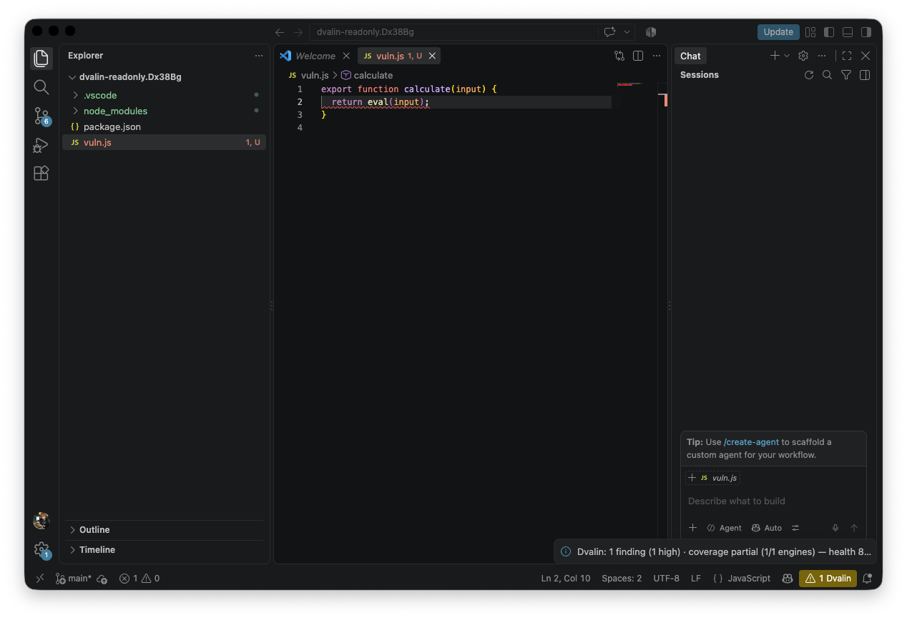

# Dvalin Security plugin

One portable plugin payload for Codex and Claude Code. It shares the same
autonomous security-gate skill across both ecosystems, while the verifier—not
the model-specific client—remains the source of the verdict.

The package uses the current portable root `plugin.json` format and retains
`.codex-plugin/plugin.json`, `.claude-plugin/plugin.json`, and `.mcp.json` as
compatibility files. The repository's
`.agents/plugins/marketplace.json` exposes it to Codex desktop as an available
local plugin; it is not enabled merely by cloning the repository. The portable
Codex package is intentionally skill-only: Codex runs plugin-owned stdio
processes from the installed plugin directory, so bundling `--workspace .`
would scan the plugin cache instead of the user's project. `.mcp.json` remains
the Claude compatibility connection.

For the lightest Codex setup, install only the MCP server:

```sh
npx dvalincode mcp-install codex
codex mcp list
```

To add the contextual security skill from this checkout as well:

```sh
codex plugin marketplace add /absolute/path/to/dvalincode
codex plugin add dvalin-security@dvalincode-local
```

Start a new Codex session after MCP installation. The server initialization response
teaches Codex the scan → inspect → verify sequence even without the packaged
skill. Installing the plugin additionally makes that workflow discoverable from
security-sensitive task context.

For development validation:

```sh
python3 ~/.codex/skills/.system/plugin-creator/scripts/validate_plugin.py integrations/dvalin-security
claude plugin validate integrations/dvalin-security
```

The MCP server starts with:

```sh
npx -y dvalincode mcp-serve --workspace .
```

Scanning and offline fix-record verification need no model, API key, or cloud
account. `dvalin_scan` is read-only and persists no state, so clients can allow
it by default. A local workflow is created only when
`dvalin_begin_verification` is explicitly called; project commands run only
when `dvalin_verify_findings` is subsequently called.

## Client permission behavior

- Codex consumes the MCP `readOnlyHint`, so `dvalin_scan` works with
  `approval=never`; workflow creation remains a separate state-changing tool.
- Claude Code deliberately requires explicit permission for every MCP tool,
  including read-only tools. Approve the scan once interactively, add only
  `mcp__plugin_dvalin-security_dvalin__dvalin_scan` to the permission allowlist,
  or pass it through `--allowedTools`. Do not use `bypassPermissions` for this.

The plugin cannot silently grant that Claude permission: plugin-shipped
`settings.json` supports only agent/status-line defaults. This preserves
Claude's trust boundary while keeping the grant as narrow as one read-only
tool. See Anthropic's [MCP permission documentation](https://code.claude.com/docs/en/agent-sdk/mcp).

Verified from this source tree on macOS on 2026-09-03:

| Client | Permission mode | Result |
|---|---|---|
| Codex 0.149.1 | `approval=never`, read-only sandbox | scan called, correct finding, no workflow state |
| Claude Code 2.1.197 | `dontAsk`, exact scan-tool allowlist | skill loaded, scan called, correct finding, no workflow state |

The packaged extension was also installed into a clean VS Code 1.134.0 profile.
The real editor result below shows the shared fixture finding and partial
coverage status from the same local scanner contract.


